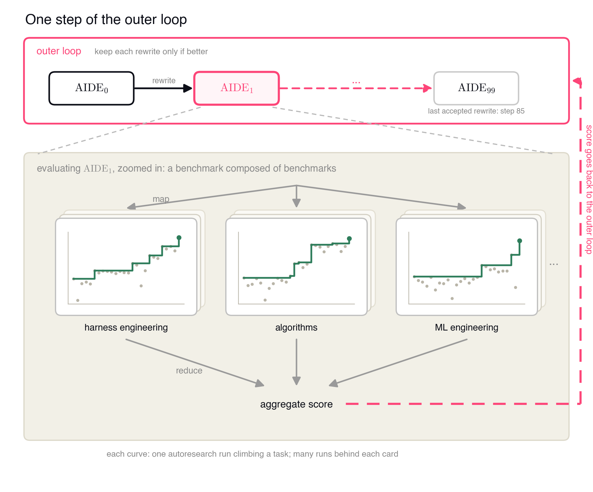
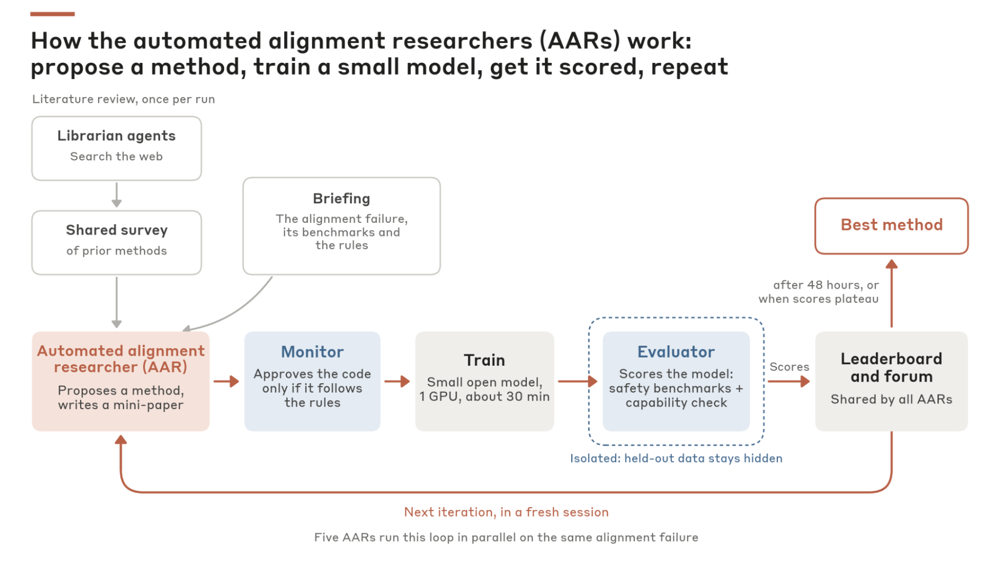

# 企业 RSI 中的 Memory 设计：大厂与 Startup 的官方博客和方法

自动研究要持续变强，前提是每一轮的经验能进入下一轮。本文从企业近半年的官方材料出发，沿 Memory 设计展开：**保存什么、怎样进入下一轮、怎样更新与遗忘、是否训练进权重，以及怎样检验记忆本身的质量**

各节按经验的生命周期排列：先看单次搜索内的上下文组装（Weco），再看跨会话的研究记录（Anthropic）、kernel 工程中的经验与执行证据（AMD、Alibaba、NVIDIA）、专门的记忆维护（Mem0、Letta），最后看经验训练进模型权重（Sakana）

## 材料范围

范围为 **2026-04-19 至 2026-10-19**，以企业官方博客、技术文章和作者维护的实现为主。旧项目只收录这个窗口里的新报告或明确版本更新

| 企业 / 团队 | 近期官方材料 | 发表时间 | Memory 设计的看点 |
|---|---|---|---|
| Weco AI | [4 Levels of RSI](https://www.weco.ai/blog/4-levels-of-recursive-self-improvement)、[AIDE²](https://www.weco.ai/blog/first-evidence-of-recursive-self-improvement) | 2026-07-10、07-14 | 按当前操作从搜索树中选取历史 |
| Anthropic | [Automated Researchers](https://www.anthropic.com/research/automated-researchers-mitigate-alignment-failures) | 2026-08-28 | 每轮重置 session，靠持久 memory file 与共享论坛延续研究 |
| AMD | [GEAK v4](https://www.amd.com/en/developer/resources/technical-articles/2026/geak-v4.html) | 2026-07-23 | 已验证规律写成 learned cards，只用于提出候选 |
| Alibaba | [Atrex Kernel Agent v0.3.0](https://github.com/alibaba/atrex-kernel-agent/releases/tag/v0.3.0) | 2026-09-23，release | 实时状态与正式结果分开记录，按后续用途划定归档范围 |
| NVIDIA | [KDA² / KDA v0.6](https://nvlabs.github.io/kda/blog/2026-09-27-kda-for-kda/) | 2026-09-27 | 跨任务 KernelWiki 与任务工作区两层记忆，经验绑定验证条件 |
| Mem0 | [Memory Decay](https://mem0.ai/blog/introducing-memory-decay-in-mem0)、[Dream](https://mem0.ai/blog/dream-background-memory-consolidation-for-ai-agents) | 2026-05-08、08-04；分别更新于 09-03、09-28 | 合并、替代、归纳与按访问历史降权 |
| Letta | [Trajectory](https://www.letta.com/blog/trajectory/)、[Evaluating Memory in Production Agents](https://www.letta.com/blog/evaluating-memory-in-production-agents/) | 2026-07-23、07-28 | 统一轨迹格式、后台 dreaming，分别评测记忆的使用与生成 |
| Sakana AI | [RSI Lab](https://sakana.ai/rsi-lab/)、[MASS](https://pub.sakana.ai/mass/) | 2026-06-05、10-12 | 筛选执行轨迹，训练进共享模型权重 |

Poetiq、OpenAI、Google DeepMind 和 Hillclimb 的近期材料与 Memory 设计关系较弱，汇总在[第 8 节](#8-其他企业-rsi-材料)

<!-- 日期：Sakana RSI Lab 按官方博客索引 https://sakana.ai/blog/ 的首发日期；MASS 按 https://sakana.ai/mass/ 的博客发布日期，论文首发为 2026-10-08。Mem0 日期按文章正文 byline，页面 metadata 另标 10-13。Cursor multi-agent-kernels 与 Anthropic 最初的 Automated Alignment Researchers 均发表于 2026-04-14，超出当前窗口，未列为近期成果。AlphaEvolve 2025 首发及 Sakana Lab 回顾的旧论文不重新计为新方法。Recursive 6 月文章只公开了结果，没有研究系统的技术细节，已移除 -->

## 总览：经验存在哪里，怎样进入下一轮

| 企业 / 系统 | 经验载体 | 怎样进入下一轮 | 更新与遗忘 |
|---|---|---|---|
| Weco AIDE² | 候选解树、执行结果、近期摘要 | harness 规则按操作选取摘要、完整解和反馈 | 只裁剪本轮上下文，搜索树完整保留 |
| Anthropic AAR | 个人 memory file、共享 survey / forum / leaderboard、代码快照 | 新 session 读取持久记录，沿用已有方法和代码 | 每轮清空会话历史，研究记录保留 |
| AMD GEAK v4 | 运行内记录、跨次 learned cards、参考知识库 | 按 kernel / GPU / regime 提出候选，再实际验证 | 只有已验证规律进入卡片 |
| Alibaba Atrex | 实时 journal、`live.json`、Supervisor 的版本记录 | 支持 episode 恢复和结果复核 | 活动状态与正式记录分开，归档只收录后续用得到的产物 |
| NVIDIA KDA | 跨任务 KernelWiki + 当前任务工作区 | Wiki 规则检索，工作区回看候选与执行证据 | Wiki 可纠错、撤回、检查时效 |
| Mem0 | 带状态与替代关系的记忆条目、归纳记忆 | 相关性搜索，再按状态过滤、按访问时效排序 | Merge / Supersede / Synthesize + 软降权，原记录保留 |
| Letta | 标准化轨迹、记忆文件、skills、消息历史 | 后台 dreaming 整理，Agent 按需查文件与历史 | 由 Agent 归纳、去重、修复陈旧内容 |
| Sakana MASS | workflow、执行轨迹、共享模型权重 | 筛选轨迹后做 LoRA，模型继续承担三个角色 | 经验内化进权重 |

“遗忘”在这些系统里对应四种不同操作：**上下文裁剪**（Weco）、**会话重置**（Anthropic）、**状态替代与检索降权**（Mem0、KDA）、**归档范围筛选**（Atrex）。它们都能减少旧经验对当前决策的干扰，保留的信息和重新找回的成本各不相同。没有一家按经验在后续任务上的实际收益决定删除

## 1. Weco：从搜索树按操作组装上下文

AIDE² 的内层 Agent 做具体研究任务，外层 Agent 修改内层 harness 的源码。每次改写后，候选 Agent 在相同成本约束下完成多个研究任务，以私有评分决定是否接受新版本。外层使用 Claude Opus 4.7，内层使用 Gemini 3 Flash，内层承担大量重复评测

图中每张卡片代表一类任务中的多次研究运行，聚合评分回到外层。接受的产物是下一版 Agent 源码

### Memory：同一棵搜索树，按操作给不同视图

候选解树保存代码、执行反馈、分数与派生关系。外层改出的最终版本里，Prompt 构造器按 draft、debug、improve、eval review 等操作选取不同内容，替代整段历史拼接

| 当前需要的信息 | 进入上下文的形式 |
|---|---|
| 近期尝试 | 最新 12 条单行摘要，加一个完整解 |
| 评测结果检查 | 输出去重、截取头尾，上限 32k |
| 调试 | 原始执行输出的尾部 |
| 是否进入平台期 | 最近 4 个分数形成的信号 |

Prompt 平均缩小约 16 倍，省下的 token 重新投入搜索。这套设计由 Agent 自己改出来，说明“给当前操作看哪些历史”本身就是可搜索的对象

搜索策略也围绕历史组织：每个初始 draft 的子树作为 bandit 的一个 arm，分配不同 lineage 的预算；最佳 lineage 停滞后，复制全局最佳代码，以新策略开启新 lineage。这与 [Scaling Discovery Requires Forgetting](speaker1.md#5-scaling-discovery-requires-forgetting保留解重置搜索历史) 的“保留最佳解、重开搜索”思路接近

### Ignition Test：改进者是否更会改进

| 博客实验 | 报告结果 |
|---|---|
| 外层搜索 | 100 次改写评测，约 8 天，约九成提案被拒 |
| 被接受的连续改进版本 | 7 个 |
| 改进后的 AIDE47 坐到外层 | 约 20 步达到与原外层（约 40 步）相同的上限，效率差异不显著 |

作者因此没有宣称实现 ignition。另一个细节：系统曾产生统计式反作弊组件，后续 mutation 把它改坏了，最终版本中该组件没有实际作用。**Agent 写出了某种机制，和该机制真正贡献收益，是两件事**

对 KernelGen，可让外层只改上下文构造、搜索策略或 profiling 流程，保持生成模型和硬件 evaluator 固定

<!-- Weco 方法来自官方博客 §1、§2.4、§3.1；图片来自 https://www.weco.ai/assets/blogs/first-evidence-of-recursive-self-improvement/figB_outer_loop.png，未修改图中内容。debug 历史仅在近期 bug rate 超过 15% 时加入；输出 guard 在 step 63 由 Agent 自行诊断崩溃后加入。博客 7 月的 reward-hacking 数值与 9 月论文口径不同，本文未混用；正式论文 https://arxiv.org/abs/2609.26457 -->

## 2. Anthropic：重置会话，保留研究记录

8 月的 Automated Researchers 工作让 Agent 针对欺骗、迎合、隐私、jailbreak 等对齐问题提出训练方法，再独立训练和验收。被更新的是目标模型，研究者 Agent 本身不变

| 环节 | 做法 |
|---|---|
| 准备文献 | 4 个 librarian agents（Claude Sonnet 4.6）分领域整理共享 survey，记录方法与复现要点 |
| 并行研究 | 每种 failure 由 5 个 Claude Opus 4.8 AAR 并行提出训练方法 |
| 固化提案 | 训练前写 mini-paper，明确 loss、数据构造和训练配置，在看到结果前绑定不可变记录 |
| 代码审查 | 一个 monitor 检查代码是否违反数据与蒸馏约束，另一个检查代码与提案是否一致；代码改动后重新审查 |
| 训练预算 | 每个方法 1 张 H200，约 30 分钟 |
| 独立评测 | 隔离的 evaluator 读取权重，返回 benchmark 成绩与通用能力回归 |

### Memory：会话与研究记录分开管理

| 载体 | 内容与用途 |
|---|---|
| 每个 AAR 的持久 memory file | 自己尝试过的方法与分数，新 session 从这里接着研究 |
| 共享 survey | Librarian 整理的方法与复现要点，运行中 AAR 也可以追加 |
| 共享 forum 与 leaderboard | 其他研究者的方法、分数与代码快照，可直接在已有代码上修改 |

每次迭代开启新 session，连续性只来自这些文件，不来自不断增长的对话。**清空上下文与丢掉实验经验因此可以分开控制**：对话历史定期清空，方法、分数与代码长期保留。召回方式是 Agent 自己读文件，没有检索器

这个设计适合拿来研究长期失败历史是否抑制探索：memory file 记录的失败方法，可能像 Forgetting 论文里的搜索历史一样，影响新 session 是否还敢尝试相近方向

### 验收：记忆中的分数要可信

评分取各 benchmark “closed fraction”（从基线到最优的差距被缩小的比例）的几何平均，任一项不提升总分即为零；MMLU、GSM8K 或 IFEval 的 95% CI 整体低于基线的方法被淘汰。Held-out benchmark 在 OS 层隔离，用来从领先方法中挑选；Petri 多轮审计不参与选择，作为终测；方法还迁移到大 1.8–4.7 倍的模型上检验

写进 memory 和 leaderboard 的分数会被后续 Agent 当作经验继承，验收越严，继承下来的经验越干净。迁移到 kernel：训练前固化优化假设，候选运行后由隔离 evaluator 同时检查 correctness、性能与回归，原始数据和验收程序不交给搜索 Agent

<!-- 方法详述：https://alignment.anthropic.com/2026/automated-alignment-researchers/，§2–§3、§5；librarian 模型、两类 monitor、不可变提案、fresh session、几何平均与 capability gate、held-out 的 selection 作用均取自该报告。每次运行最长 48 小时或到平台期为止。§6 的生产规模实验改用 Claude Sonnet 5 作为 AAR。图片为该报告 fig2.png，未改动。未将窗口外 2026-04-14 的 weak-to-strong 实验数值混入 8 月研究；When AI builds itself（09-18 更新）只有内部研发使用统计，未纳入 -->

## 3. Kernel 工程中的 Memory：经验提出候选，执行证据决定接受

### AMD GEAK v4：已验证规律写成卡片

GEAK v4 用 JavaScript Workflow 控制循环、并行、预算、验收与停止，LLM 负责提出策略和代码。系统层先 profile 真实 workload、按 Amdahl 影响排序，再调用 kernel 层优化，最后回到 serving 重新测量

经验分三类

| 类型 | 来源与内容 | 用途 |
|---|---|---|
| 运行内记录 | 本次运行的方向、独立 speedup、端到端变化与结论 | 当前运行后续决策 |
| 跨次 learned cards | 按 kernel 类型、GPU 与 regime 保存已验证的规律 | 为下一次运行增加候选方向 |
| 参考知识 | `perf_knowledge` 按算子、backend、GPU、dtype、regime 组织知识矩阵；`expert_skills` 是人写的优化 recipe，附匹配条件与已测结果 | 提供先验方向 |

关键原则是**历史经验只用来提出候选，不能代替测量，也不能直接排除需要尝试的路径**。错误经验最多浪费一次尝试，不会过早封死搜索方向

| 设计 | 对 KernelGen 的作用 |
|---|---|
| 先做配置与 backend 筛选，再写新 kernel | 用较小成本先验证优化空间 |
| 独立验证与端到端回测 | 避免单 kernel 加速没有改善实际 workload |
| 卡片带 kernel / GPU / regime 条件 | 经验复用时先判断适用范围 |
| JS 控制状态与停止 | 将预算和流程约束变成可执行逻辑 |

### Alibaba Atrex：实时状态、正式结果与归档范围

Atrex 的长 episode 在隔离 Git worktree 中进行 profile、研究、编辑与验证，结束时给出结构化 handoff。Supervisor 核对代码与 journal，在同一 GPU allocation 下按 incumbent、candidate、candidate、incumbent 的 ABBA 顺序比较；通过 correctness 且严格改善的候选才替换 incumbent

| 记录 | 更新者与时机 | 作用 |
|---|---|---|
| Episode journal | 探索过程中持续追加结构化实验 | 保存假设、修改、验证与失败信息 |
| `memory/live.json` | 每次 journal 追加后原子刷新 | 暴露活动 episode 的实时状态，不参与版本选择或晋升 |
| `memory/vN.json` | Supervisor 写入正式结果 | 保存 outcome 和结构化实验，包含失败与中断结果 |
| Trace-retention manifest | 运行结束或可处理的中断时生成 | 声明后续知识提取需要的代码、正式 Memory、journal、评测、Wiki 查询与精简 profiler 报告 |

两个设计值得借鉴。一是**失败也写进正式记录**，后续可以回溯为什么某个方向不行。二是**按后续用途决定归档什么**：manifest 不收录原始 session JSONL、stdout / stderr 和大型 profiler capture，只留知识提取用得到的部分。这相当于在写入阶段就做了一次遗忘

中断时保留 worktree、实验记录和恢复信息，可以延续同一次 episode。新任务怎样召回历史 episode，README 没有展开

<!-- AMD 机制来自 GEAK v4 官方文章 Two-altitude architecture / Evidence-gated learning / perf_knowledge；Atrex release 与 long_horizon/README.md 静态核对，源码固定于 5ad94ffaa815f066eabce073d2a920a91b715b0a。ABBA 仅表示交错计时协议，不能替代更多重复与噪声估计 -->

### NVIDIA KDA：经验与验证条件一起记录

KDA 的 Memory 分两层：跨任务的 KernelWiki 按架构、语言、症状和置信度规则检索，知识页可纠错、撤回并保留出处；任务工作区保存候选父子关系、benchmark、profile 与失败原因。构造流程、规模和两层衔接见[第一人展示稿 §3](speaker1.md#3-kda--kernelwiki经验怎样总结更新与撤回)

企业视角下值得补充的是验收：9 月博客中的失败候选利用输入分布、硬编码边界绕过通用实现，作者随后加入隔离的随机分布、fresh seeds 与真实模型轨迹。**经验必须和它通过的验证条件一起入库**，否则测试漏洞会被当成通用 trick 积累下来

## 4. Mem0：把记忆整理做成独立的维护过程

Mem0 是 Agent Memory 基础设施公司，近期的 Dream 与 Memory Decay 分别处理两类问题：重复、冲突的记忆怎样整理，以及大量旧记忆怎样影响当前召回。公开案例以用户事实与偏好为主，用于 kernel 经验时要加入硬件、版本和测量条件

### Dream：合并、替代、归纳分别处理

写入新记忆时，extraction 只能看到当前对话和少量相似记忆，跨会话的重复与冲突容易漏掉。Dream 把维护拆成三个动作

| 动作 | 触发时机 | 条件与处理 | 旧记录怎样影响后续读取 |
|---|---|---|---|
| Merge | 写入时 | 新记忆完整包含旧内容并有补充，旧条目标为 `merged`，指向更完整的条目 | 默认隐藏；`include_merged=true` 可找回 |
| Supersede | 写入时 | 同一事实有明确的新版本，旧条目标为 `superseded`，指向替代条目 | 默认仍返回并带状态；`latest_only=true` 才排除 |
| Synthesize | 后台定期 | 多个独立观察支持同一模式时，新增高层概括并记录来源 ID | 原始记忆保留，与概括并存 |

Merge / Supersede 依赖相关旧记忆已进入写入上下文，关系不明确时不修改。状态由 `lifecycle_state` 和 `replacement_memory_id` 表达，原记录不做物理删除，标为 `immutable` 或 `exclude_from_dream` 的条目跳过整理

一个容易忽略的点：**标为过时，默认检索仍会返回它**。被替代的旧事实常常有历史价值，调用方要当前有效事实，需要显式选择读取模式

### Memory Decay：按访问历史调整召回排序

Decay 作用于相关性搜索之后：扩大候选池，按访问时效缩放相关性分数，再截取结果

| 项目 | 做法 |
|---|---|
| 时效信号 | 每条记忆最多保留最近 20 次访问时间；旧记录以最后更新时间回退 |
| 分数缩放 | 近期访问最高约 1.5× 加权，闲置数周逐渐降至约 0.3× |
| 保留方式 | 只降低排序，不隐藏、不删除 |

访问频率与技术正确性无关，错误经验也可能因频繁召回而被强化。对 KernelGen，替代关系比时间衰减更有用：编译器升级后把旧 recipe 标成特定版本适用，默认检索当前条件的条目；通用硬件规律、临时调试信息和已被反证的结论应采用不同规则

<!-- Dream 当前读取语义另核对 https://docs.mem0.ai/platform/features/dream。docs 说明 Synthesis 当前按单独 user_id 的记忆运行，带 agent_id/run_id/app_id 的记忆不在范围内，用于研究任务库时要另行设计经验归属。Decay 没有公开完整衰减公式。本文介绍 Platform 功能，未认定开源版具有完全相同实现 -->

## 5. Letta：统一轨迹格式，后台整理，再检验记忆是否改变行为

Letta 做有持久状态的 Agent，近期材料把经验处理拆成三步：可读的轨迹格式、后台 dreaming、Memory 能力评测

### Trajectory：先让历史可以被模型高效阅读

`@letta-ai/trajectory` 将不同 Agent harness 产生的会话统一成记录序列

| 记录 | 主要字段 |
|---|---|
| `meta` | 来源 harness、工作目录、Git branch、模型 |
| 消息 | `user / assistant / reasoning` 与内容，reasoning 仅在原系统暴露时保留 |
| 工具交互 | 工具名、参数与结果，用 `tool_call_id` 关联 |

转换去掉重复 payload、界面事件与内部 bookkeeping，可截断过长工具结果，采样会话约缩小到原 token 的五分之一。原始记录另存，用于完整回放与审计

处理顺序是：**标准化历史 session → 初次建立 Memory → 后台 dreaming 阅读近期 session、归纳持久经验 → Agent 按需查询记忆与历史文件**。同一个整理过程可以消费不同 harness 的轨迹

### 把“用好记忆”和“生成好记忆”分别验收

Context-Bench V2 的 Memory profile 包含上下文内记忆、MemFS（Git 管理版本的记忆文件系统）中的外部文件、可加载 skills 和消息历史。每个场景跑两遍：一遍用积累后较混乱的原始记忆，一遍用整理后的版本

| 维度 | 检查什么 | 典型失败 |
|---|---|---|
| Usage：retrieval | 发现信息缺失，主动找相关记忆或 skill | 只依赖当前上下文，直接回答 |
| Usage：adherence | 实际遵循已保存的有效规则 | 取到了记忆，行为仍不执行 |
| Generation：generalization | 从具体反馈归纳可复用规则 | 已有三条带日期的纠正，又追加第四条 |
| Generation：hygiene | 修改旧内容、去重、清理陈旧信息并维持结构 | 同一规则散落三处，只改一处，留下冲突副本 |

**能写出好代码，与能把经历整理成好记忆，是两种能力**。只统计新增了多少 memory 或 skill，会漏掉重复、冲突和错误泛化。daVinci-kernel 的技能库只追加，缺的正是 hygiene 这一环

对 KernelGen，可以用同一组实验记录比较“只追加总结”和“修改、合并已有经验”，再测后续未见任务的 correctness、搜索成本与性能

<!-- Letta 两篇均为 2026-07 官方文章。Trajectory schema 与 token 样例见正文；dreaming 对跨 harness 轨迹的支持见 How we're using trajectory。Context-Bench V2 为 private benchmark，Sonnet-5 模拟用户、GPT-5.6-Sol 按场景 rubric 评分；场景来自 office manager、support、personal assistant、coding 四类内部 Agent -->

## 6. Sakana：把筛选后的经验训练进共享模型

RSI Lab 的路线是把自动研究、程序演化与模型开发连接起来，MASS 是其中有明确循环设计的近期工作，合作方为 UC Berkeley，作者含 Matei Zaharia、Yujin Tang

### MASS 的内外循环

同一个模型分别承担 executor、workflow optimizer 和 evaluator

1. 固定模型权重，搜索团队 workflow，改变任务如何分工、结果怎样交接，以及哪些检查必须完成
2. Evaluator 比较候选结果与已有 champion，optimizer 根据反馈提出下一版 workflow
3. 对选中的 workflow 多次 rollout，由当前模型挑选较好的执行轨迹
4. 去掉训练输入中的 workflow 文本，对 orchestrator 与 subagent 轨迹做 LoRA 训练
5. 新模型再次承担三种角色，开始下一轮

### Memory：从外部轨迹到模型权重

搜索阶段的经验在外部：workflow、反馈历史和执行 workspace。外层再把其中的行为训练进权重

| 环节 | 做法 |
|---|---|
| 收集 | 每个任务将 champion workflow 执行 18 次，记录消息、工具调用与结果 |
| 选择 | 当前模型两两比较 workspace，拟合 Bradley–Terry 分数排序 |
| 保留 | 每个任务最多 16 条轨迹，15 条训练、1 条 validation |
| 内化 | 移除 orchestrator 输入里的 workflow 文本，对 orchestrator 与 subagent 对话做 LoRA |

去掉 workflow 文本是关键：模型要从任务本身学会怎样组织协作，经验从“读到的提示”变成“默认的行为”。这条路线没有外部记忆的检索与遗忘问题，代价是经验不可单独检查、撤回或按条件启用

| 实验设置或观察 | 公开结果 |
|---|---|
| 起点与环境 | Qwen3.6-27B，qwen-code，完整循环 2 轮 |
| 四个研究 benchmark | 第二轮 score / output token 为底座的 1.2–1.6 倍 |
| 研究之外的 benchmark | Terminal-Bench 2.0 为 0.96×，SWE-bench Verified 为 0.94× |
| 固定底座执行不同代搜索出的 workflow | 第一轮搜索产物对底座搜索产物的胜率为 64% |
| 与外部 judge 的判断一致率 | 73% → 93% |

研究任务上的提升伴随通用编码任务的小幅退化，训练进权重的经验同样需要回归检查。score / output token 不含搜索与训练成本

固定 executor 的对照中，用 GPT-5.5 同时担任 evaluator 和 optimizer，12 个任务都在 5 轮内找到更优 workflow；只换 evaluator 为 10 个，弱于完全同构的 11 个。作者据此认为瓶颈可能在 optimizer：反馈再好，也要能转化成有效修改

对 KernelGen，一个直接的实验是固定 kernel 生成模型与真实 GPU evaluator，只训练或替换 optimizer，测它能否在新任务上更快找到有效方向

<!-- MASS 具体流程与两轮设置来自详细博客；公开实现入口 https://github.com/SakanaAI/mass，复现覆盖说明见 docs/reproduction.md 与 docs/experiment_coverage.md。Workflow transfer 表另报告 80%（第一轮 executor 对底座）与 63%（底座用第一轮 workflow 对无 workflow）；作者注明搜索时三个角色共同变化，不能单独归因于 optimizer。RSI Lab 成立文章是路线说明，回顾的 2024–2025 成果不作为近半年新实验 -->

## 7. Memory 设计的取舍

| 设计问题 | 已有做法 | 代表 |
|---|---|---|
| 保存什么 | 原始轨迹标准化后再归纳；只保存已验证规律；失败与中断结果也写入正式记录；按后续用途划定归档范围 | Letta、GEAK、Atrex |
| 怎样进入下一轮 | harness 按操作选取历史；Agent 自己读文件；相关性检索加时效排序；按硬件与条件规则检索 | Weco、Anthropic / Letta、Mem0、KDA / GEAK |
| 怎样更新与遗忘 | 裁剪本轮上下文；每轮重置会话；标记替代并保留指针；纠错撤回保留出处 | Weco、Anthropic、Mem0、KDA |
| 是否进入权重 | 筛选轨迹后 LoRA，去掉提示文本促使行为内化 | MASS |
| 怎样检验记忆本身 | 分开评测记忆的使用与生成；经验只提出候选，由执行证据决定接受 | Letta、GEAK |

三点共识可以直接用在 KernelGen 的 Memory 设计上

- **经验与验证条件绑定**：GEAK 的卡片带 kernel / GPU / regime，KDA 的失败案例说明经验要和通过的验证条件一起入库。条目至少记录适用硬件、软件栈、输入范围和 verifier 版本
- **经验只提出候选，执行决定接受**：历史经验影响搜索方向，最终靠当前设备上的 correctness 和性能证据。错误经验的代价因此被限制在一次尝试
- **“不再看”和“删掉”分开**：会话重置、上下文裁剪和替代标记都不销毁原始记录，审计与恢复依赖保留下来的历史

各家都没做的是**按经验在后续任务上的实际收益决定保留或淘汰**。最值得做的对照是：固定模型、GPU 与总预算，让同一份历史经验分别经过直接追加、按条件筛选、合并与替代、会话重置，比较未见算子上的 Correct@8、speedup 与求解成本，同时统计信息丢失导致的重复试错

如果只精读几份材料，建议按这个顺序

1. **AMD GEAK v4 / Alibaba Atrex**：kernel 场景下经验的字段、适用条件，以及活动状态与正式结果的区分
2. **Anthropic AAR**：会话重置与持久研究记录分离，以及让继承下来的分数可信的验收设计
3. **Mem0 Dream / Letta Memory Evaluation**：经验怎样合并、替代、降权，以及记忆维护能力怎样评测
4. **Weco AIDE²**：上下文构造作为可搜索对象，以及 ignition test 的问题定义
5. **Sakana MASS**：经验训练进权重的完整流程与回归代价

## 8. 其他企业 RSI 材料

以下材料与 RSI 相关，但 Memory 设计的公开内容很少

| 企业 | 近期材料 | 做了什么 | 与 Memory 的关系 |
|---|---|---|---|
| Poetiq | [RSI Perspective](https://poetiq.ai/posts/rsi_perspective/)、[Augur](https://poetiq.ai/posts/augur/)、[LLM Router](https://poetiq.ai/posts/llm_router/)，2026-08-04、08-10、10-15 | Metasystem 自动构建任务 harness；Augur 把失败分为缺事实、组合推理错误、来源矛盾，分别生成监督数据、构造 RL 任务或剔除；Router 经 12 小时自动优化，准确率 82.3%、成本 $27.83，高 effort Opus 5 为 81.8%、$32.80 | 提到跨任务策略库与模型能力地图，条目格式与更新规则未公开 |
| OpenAI | [Research acceleration](https://openai.com/index/research-acceleration-view-inside-openai/)，2026-09-06 | 按 Decide、Design、Build、Run、Analyze、Communicate 六阶段统计内部研发：8 月中旬 Agent runtime 约为每人类工作日 3.1 个 Agent 工作日；成功的 4–8 小时任务过半至少有一次人工介入 | 未涉及 Agent 的 Memory 实现 |
| Google DeepMind | [AlphaEvolve: Scaling impact across fields](https://deepmind.google/blog/alphaevolve-impact/)，2026-05-07 | 演化搜索进入 TPU 电路设计、cache 替换策略、Spanner compaction（write amplification 降低 20%）、编译器，并让 Klarna 训练速度翻倍 | 候选数据库是单次搜索的状态，没有跨任务经验管理 |
| Hillclimb | [DeepRSI](https://www.deeprsi.com/blog/)，2026-10-12 | 15 个 ML 研究任务（含 GPU kernel），每模型 2 次 48 小时运行；public verifier 提供反馈，private verifier 终评快照与最终代码 | 快照用于审计，不供 Agent 检索；可借鉴为 Memory 对照实验的评测协议 |

<!-- Poetiq Coding 结果来源 https://poetiq.ai/posts/recursive_self_improvement_coding/，2026-05-14。Router 的 Budget-Router 为 80.0%、$17.00；不确定时额外调用 LLM 的比例少于 1%。OpenAI 3.1 个 Agent 工作日按原文 8 小时工作日计算，属于 runtime 量，不是 3.1 倍生产率。AlphaEvolve 基础算法 2025-05-14 首发，不列作新进展 -->

与 Kernel Agent 的具体论文和实现对照，可看[主调研](main.md)；参数更新与训练信号见[模型训练专题](model_training.md)
