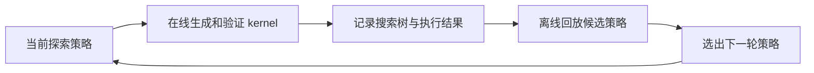

# Kernel Agent 的 RSI 近期进展调研

## 两人分享的简要分工

两人按以下顺序介绍：先讲经验如何积累、筛选、复用与遗忘，再讲搜索策略与 harness 如何自我改进

| 顺序与分工 | 介绍重点 | 对应文章 |
|---|---|---|
| 第一人：经验的积累、筛选与遗忘 | 经验怎样提炼、存储、检索和参与训练，哪些历史需要退出上下文，以及收益怎样验收 | [daVinci-kernel](https://arxiv.org/abs/2606.16497) 为积累主线；[KDA² / KDA v0.6](https://nvlabs.github.io/kda/blog/2026-09-27-kda-for-kda/)讲知识维护与验收；[KOPE](https://arxiv.org/abs/2608.25570) 讲经验图、上下文管理与迁移；遗忘重点讲 [Scaling Discovery Requires Forgetting](https://arxiv.org/abs/2610.20563) |
| 第二人：搜索策略与 harness 的自我改进 | 更新哪些机制、怎样接受新版本，以及如何证明 agent 更会继续改进自己 | [Dream-RSI](https://arxiv.org/abs/2609.14858)、[AIDE²](https://arxiv.org/abs/2609.26457) 为主；[MASS](https://pub.sakana.ai/mass/) 补充改进能力评测 |

## 摘要

本文检索到的近期 Kernel Agent 自我改进工作主要落在搜索策略、持久记忆、agent harness 和模型训练四个层面。论文之外，官方博客和开源代码已经展示了跨轮记忆、长时搜索、独立验收和 serving 集成的具体实现。近期也开始出现优化者能力随训练提高的实验，但通用性和持续加速仍需进一步验证

研究机制优先读 Dream-RSI、AIDE²、daVinci-kernel 和 MASS；经验迁移补看 EvoMem、SAGE 与 KOPE，工程实现优先检查 GEAK、Atrex 与 KDA。这些材料分别回答搜索怎样改进、经验怎样训练和复用、结果怎样验收。本文同时比较论文、技术博客和 GitHub 项目，具体结果均保留各自的评测口径

## 范围与判断口径

时间窗口为 **2026-04-14 至 2026-10-14**。
遗忘专题的材料按首次公开日期限定在 **2026-04-16 至 2026-10-16**，覆盖论文、官方技术文章和作者仓库；旧论文在期内的修订不重新计入
 <!-- 论文按首次公开日期筛选，技术文章按发布日期筛选；已有 GitHub 项目只分析窗口内明确的 release、功能里程碑或工程报告，并单独标明日期依据。持续更新的作者文章注明实证更新日期，仓库最后一次提交时间只用于固定检查快照 -->

<!-- 优先查阅原文、作者博客和官方源码；community awesome list 只用来发现线索。期内论文修订用于核对结果，旧论文的修订和会议发表不作为新工作计入。GitHub 部分做了静态代码与文档检查，未安装或运行这些项目 -->

<!-- 检索中排除了 Kernel Autoresearch for Open-Ended Model Discovery（2610.10394）：其 kernel 指统计学习中的核函数，与本文的 GPU kernel 工程范围不同 -->

这里的 Kernel Agent 指生成、验证和优化 GPU / accelerator kernel 的 agent 系统。RSI（Recursive Self-Improvement，递归自我改进）的判断重点是：**这一轮积累的变化，是否进入下一轮的求解或改进机制，并在固定预算下继续产生收益**

为方便比较，本文采用以下分析口径。这套分类用于本文的证据比较

| 改进层面 | 被更新的对象 | 需要确认的收益 |
|---|---|---|
| 单题优化 | 当前任务的 kernel 代码 | 同一任务更正确或更快 |
| 跨任务积累 | memory、skills、生成 prompt | 后续任务在同预算下更容易求解 |
| 改进机制更新 | 搜索策略、工具、上下文管理、agent 源码 | 新机制在独立任务上优于旧机制 |
| 改进能力递归提升 | 负责产生下一代 agent 的机制 | 新机制继续自我改进时，比旧机制更有效 |

最后一层需要单独测量。[Weco 的 RSI 分级文章](https://www.weco.ai/blog/4-levels-of-recursive-self-improvement)把它称为 ignition：让新旧改进者从相同起点出发，在相同预算下比较它们产生的下一代系统。只看到最终 kernel 更快，或 agent benchmark 更高，还不足以确认这一层

## 有 kernel 实验的近期工作

作者单位以论文署名为准；博客与开源项目标明发布团队、署名作者或贡献者角色。下表按研究问题组织。结果来自作者报告，本次调研没有运行复现实验；任务集、硬件、搜索预算和候选选择方式不同，表中数值不能直接排列成榜单

| 工作与原文 | 作者单位 / 发布团队与作者 | 首次公开 | 改进对象 | Kernel 证据 | 阅读时的关键约束 |
|---|---|---|---|---|---|
| [Dream-RSI: Recursive Self-Improvement through Evolving Worlds](https://arxiv.org/abs/2609.14858) | Google、Google DeepMind、马里兰大学 College Park、弗吉尼亚大学；Tong Zheng 等，含 Heng Huang；通讯作者 Xidong Wu、Zheng Zhang（[PDF 首页](https://arxiv.org/pdf/2609.14858v2)） | 2026-09-14 | 可执行的探索策略 | 4 个 KernelBench 任务，L40S | coding agent 和 evaluator 固定，搜索策略持续更新 |
| [AIDE²: Recursive self-improvement of AI research agents](https://arxiv.org/abs/2609.26457) | Weco AI；Dhruv Srikanth 等，Dhruv Srikanth、Zhengyao Jiang 为通讯作者 | 官方博文 2026-07-14；论文 2026-09-22 | research agent 的 harness 源码 | held-out kernel 的孤立计时与训练集成对比 | kernel 用于迁移和 reward hacking 检查；更强的自我改进能力结论尚不确定 |
| [EvoMem: Memory-Augmented Evolution for Code Optimization](https://arxiv.org/abs/2608.10795) | AXXX（原文署名）、Applied AI Institute、莫斯科国立大学；Viktor Volkov 等，含 Ivan Oseledets、Dmitry V. Dylov | 2026-08-11 | 成功 mutation 的结构化记忆 | 小规模 KernelBench transfer 实验 | 测的是记忆辅助搜索，改善幅度随任务和运行变化 |
| [daVinci-kernel](https://arxiv.org/abs/2606.16497) | Shanghai Innovation Institute（SII）、上海交通大学、GAIR；Dayuan Fu 等，通讯作者 Pengfei Liu（刘鹏飞）；机构全称见[首作者主页](https://fu-dayuan.github.io/) | 2026-06-15 | 联合训练技能选择、kernel 生成与技能总结，更新技能库 | KernelBench L1/L2/L3，CUDA / Triton | 新技能在原任务重跑验收；技能迁移与权重提升需分别测量 |
| [KOPE: Beyond Scaling](https://arxiv.org/abs/2608.25570) | 香港城市大学、华为 Application Software Engineering Lab；Siyuan Chen 等，通讯作者 Zhichao Lu、Qingfu Zhang | 2026-08-26 | Experience Graph Memory 与 Active Context Management | Ascend NPU 主实验，K3 RISC-V CPU 迁移实验 | 跨硬件正确率和性能迁移可能方向相反；每配置只有一次归档运行 |
| [SAGE: From Experience to Expertise](https://arxiv.org/abs/2609.35568) | 复旦大学、中国科学技术大学、华为；Longxiao Fan、Tao Zhang 等，含 Weiwei Sun | 2026-09-28 | 经验效用估计与常驻规则 | NPUKernelBench 的 88 个算子，Ascend 910C | 每算子最多 30 轮；任务按顺序形成学习流 |
| [SIA: Self Improving AI with Harness & Weight Updates](https://arxiv.org/abs/2605.27276) | Hexo Labs（[首作者项目页](https://prannayh.com/)标注，论文未列单位）；Prannay Hebbar、Yogendra Manawat 等 | 2026-05-26 | harness 与模型权重 | H100 上的 TriMul 优化 | kernel 结果来自一个工作负载，需区分各个比较基线 |
| [iCoder-27B: Recursive AI-Led Development of Frontier Industrial Coding Model](https://arxiv.org/abs/2609.29626) | 上海交通大学、新加坡国立大学、DP Technology、Endless Frontier；Cheng Yang 等；顾问署名 Junchi Yan、Shuicheng Yan、Weinan E，通讯作者 Linfeng Zhang、Qibing Ren | 2026-08-28 | 数据、训练策略、模型权重 | KernelBench L1/L2/L3、TritonBench-G | 专家先提供 Research Skills；模型开发收益与递归改进能力分开看 |
| [optimize_anything: A Universal API for Optimizing any Text Parameter](https://arxiv.org/abs/2605.19633) | UC Berkeley、MIT；Lakshya A Agrawal 等，含 Omar Khattab、Matei Zaharia、Ion Stoica | 2026-05-19 | 驱动 kernel 生成的 prompt | 31 个 KernelBench 算子，V100 32GB | 多任务搜索共享经验；属于 GEPA 的新扩展论文 |
| [Prime Agent: A Self-Improving RLM Harness](https://arxiv.org/abs/2608.23552) | Prime Intellect、普林斯顿大学、MIT；Seth Karten、Alex L. Zhang 等 | 作者标注首发 2026-08-05；arXiv 2026-08-24 | 持久状态、skills 与执行组织 | PMPP-Hard 的 edit / compile / check / profile 循环 | kernel 成绩与原生 harness 接近，尚需隔离持久改进本身的贡献 |
| [AutoEnvScaling: Automating the Data Flywheel with Terminal Agents](https://arxiv.org/abs/2610.14163) | 美国东北大学、Microsoft、斯坦福大学、华盛顿大学、UNC Chapel Hill；Simon Yu 等，含 Jianfeng Gao、Natasha Jaques | 2026-10-09 | 从 solver rollout 生成下一轮训练环境 | 附录展示 GPU kernel 环境、参考实现与执行检查 | 主要能力提升实验是 terminal agent；kernel 环境生成与 kernel 能力提升分开看 |

### Dream-RSI：用历史搜索树筛选探索策略

[Dream-RSI 的方法与实验](https://arxiv.org/html/2609.14858v2#S3)把分支选择、并行度和停止时机写成可更新的 policy。在线搜索产生代码、观测和分数；离线阶段让候选 policy 遍历已记录的搜索树，筛选后再部署到下一轮在线搜索

下面的比较对象是 Recursive Fixed Exploration，即保持同一探索策略的递归搜索；指标为满足 correctness 后的 inverse runtime，见[论文 kernel 实验](https://arxiv.org/html/2609.14858v2#S4.SS1)

| 任务 | 作者报告的收益 | 含义 |
|---|---|---|
| VGG16 | 达到相近性能，generation 数为对照的约 1/2.43 | 搜索调用效率 |
| LayerNorm | 达到相近性能，generation 数为对照的约 1/1.79 | 搜索调用效率 |
| ConvDiv | 相近发现预算下性能提高 2.09× | kernel 性能 |
| ConvMax | 相近发现预算下性能提高 1.44× | kernel 性能 |

**回放覆盖的是已经实现的搜索空间**，新的代码修改仍需在线验证。本文据此判断：这条路线适合降低策略试验成本，但需在新的在线任务上确认收益，并另计策略改写成本；generation 数减少也不能直接换算成墙钟时间或总费用的同比例下降

### AIDE²：修改 agent 自身，并用独立信号验收

[AIDE²](https://arxiv.org/html/2609.26457v1#S2)使用内外两层优化：内层 agent 改进任务代码，外层 agent 改写内层 harness。内层读取 public feedback，外层根据 private evaluation 选版本，且每个版本受相同任务预算约束。接受的版本成为后续改写的起点

| 检查项 | 论文结果 | 能支持的结论 |
|---|---|---|
| 主自我改进运行 | 8 天、99 次改写提案、7 次接受；grade 0.703 → 0.778 | 能连续找到有用的 harness 修改 |
| 额外完整运行 | 分别接受 2 次、4 次改写 | 收益出现于多次运行，幅度仍有差异 |
| kernel reward hacking | 初始 55%、改进后 32%、人工 harness 39% | 孤立 speedup 更可能在实际训练中保留 |
| ignition test | 新旧 outer agent 各 3 个 seed，终点均值 0.780 / 0.782 | 暂时无法确认改进后的 agent 更善于继续改进自己 |

以上数字采用[正式论文的实验和 ignition test](https://arxiv.org/html/2609.26457v1#S3)，kernel 检查覆盖 38 个 held-out 的 `(kernel, training-context)` 配对。[早期官方博文](https://www.weco.ai/blog/first-evidence-of-recursive-self-improvement)另报 hacking 从 63% 降到 34%，本文保留论文口径，两组数字不混用

[官方博文](https://www.weco.ai/blog/first-evidence-of-recursive-self-improvement)介绍了 plateau 后改变搜索分支、限制历史上下文增长和分层检查等修改。本文建议优先复核这些机制，再用消融区分各项贡献

### EvoMem 与 SAGE：经验怎样成为后续任务的可用知识

[EvoMem](https://arxiv.org/html/2608.10795v1#S3)将成功 mutation 提炼成带任务上下文和来源的 memory card，在后续搜索时检索少量建议。其 KernelBench 结果显示平均收益，也出现较慢的搜索；“search speedup”指达到 baseline 最终分数所需候选评估次数之比

| 工作 | 条件 | 作者结果 | 结果边界 |
|---|---|---|---|
| EvoMem | 小规模 KernelBench transfer | target metric 平均相对提高 16.89%；平均 search speedup 3.44×，范围 0.05–9.00× | 3.44×描述搜索收敛，不能解读为 kernel runtime 加速 |
| SAGE | GLM-5.2、88 个 NPU 算子、最多 30 轮 | execution rate 从 Value Memory 的 84.1% 到 95.5% | budget 内找到正确实现的比例，包含多轮修正 |
| SAGE | 同一配置下已解算子 | 86.9% 比 torch_npu 快 | 分母为 solved operators |

结果分别见 [EvoMem Table 1](https://arxiv.org/html/2608.10795v1#S5)和 [SAGE Table 1](https://arxiv.org/html/2609.35568v1#S4.SS2)。EvoMem 的记忆来源和测试任务规模较小，其 kernel 示例还允许使用 PyTorch vendor primitive，迁移到要求核心计算由生成 kernel 完成的协议时，需要重新验证

[SAGE](https://arxiv.org/html/2609.35568v1#S3)关注经验是否被实际采用：ATU 根据 adoption 记录和执行结果更新效用，UGC 将多次被采用且效用为正的经验整合为有限长度的常驻规则。它提供了更具体的记忆管理信号；adoption 与成功的相关性仍需结合消融判断，NPU 上的结果也需要单独验证能否迁移到 CUDA

### daVinci-kernel：把技能选择、使用和总结纳入同一轮 RL

[daVinci-kernel 的方法](https://arxiv.org/html/2606.16497v3#S3)由共享 LLM 权重的三个角色组成：selector 用 BM25 加 LLM 选择技能，policy 多轮生成 kernel，summarizer 从成功轨迹提炼新技能。三种角色分别计算 advantage 后联合训练，技能库按训练 step 保存快照，适合对照现有 Kernel RL 流程研究经验如何进入训练

| 机制或结果 | 论文口径 |
|---|---|
| 技能检索 | BM25 取前 20 个，LLM 最多选 3 个 |
| 训练采样 | 每任务 3 个技能方案加 1 个空技能方案，各 4 条 rollout，共 16 条 |
| 新技能验收 | 在原任务注入候选技能重跑，首轮 speedup ≥ max(1.2, 1.2 × 原首轮 speedup) 才入库 |
| 14B 的 KernelBench Fast₁ | L1 / L2 / L3 为 37.2% / 70.6% / 32.2% |

数字见[实验配置与结果](https://arxiv.org/html/2606.16497v3#S4)。其价值在于联合优化“选什么、怎样用、怎样总结”，入库验收只确认技能对来源任务有帮助。本文建议另设未见算子验证迁移，并用冻结权重、冻结技能库和联合更新三组区分收益来源；Fast₁ 与新鲜并行 Correct@8 采用不同评测协议

<!-- 图源：https://arxiv.org/html/2606.16497v3/training_curves.svg；原图转为 PNG，未改动图中数据 -->

Figure 3 的验证集 Fast₁.₂ 曲线更支持训练稳定性：完整方案从最早记录的 checkpoint 起已在高位，随后主要围绕相近水平波动；带 skill 的 Ablation 2 / 3 / 4 则在早期相近的表现后逐步退化。最终差距较难证明持续积累让完整系统不断变强，还需训练前基线及冻结初始技能库的对照。Ablation 1 在无 skill 推理时有所上升，因此也不能将所有消融概括为退化

### KOPE：Memory Graph 与 Active Context Management

[KOPE](https://arxiv.org/html/2608.25570v1)来自香港城市大学与华为 Application Software Engineering Lab，首作者 Siyuan Chen，通讯作者 Zhichao Lu、Qingfu Zhang。它保持模型参数固定，将执行反馈写入 Experience Graph Memory，再由 Active Context Management and Injection 为下一轮组装上下文。主实验使用 Ascend 910C / AscendC / CANN Bench

#### Memory Graph：保存决策、结果与候选分支

[Experience Graph Memory](https://arxiv.org/html/2608.25570v1#Sx3.SSx2)将每次尝试同时保存为叙述记录和结构化证据

| 表示 | 保存内容 | 在检索中的作用 |
|---|---|---|
| Markdown Journal | Append-only，记录策略、代码改动、验证状态、测量与解释 | ReMe 从叙述提炼 procedural digest，支持语义检索 |
| JSON Case | 算子和输入场景、优化思路、可选 before / after code、编译与运行反馈、correctness、绝对 speedup、confidence，以及 session / step / `prev_case_id` | 测量结果与 lineage 的结构化依据，语义检索不可用时仍可精确检索 |
| Case 间的有向边 | 当前尝试从哪个 Case 对应的候选状态出发 | 保留优化顺序、同源备选分支及后继结果 |

每个 Case 最多一个前驱，由 `prev_case_id` 记录，因此图是允许分叉的有向无环森林。成功、编译失败、错误结果和性能退化都保留；只有正确且改善目标的候选才能替换 incumbent。边表示执行来源，不能据此认定前一步造成了后一步的收益

检索先按 operator、optimization layer、thought ID 或 outcome label 精确过滤，再用 Journal / digest 的语义检索补充跨任务候选。图结构进一步提供结果排序信号：设 Case 的绝对 speedup 为 $a_v$，其相对前驱的改进为

$$
r_v=\frac{a_v}{a_{\mathrm{prev}(v)}}
$$

根节点或前驱 speedup 非正时取 $r_v=1$。`effect` 根据 $r_v$ 分为 effective（$r_v\geq1.05$）、partial（$1\leq r_v<1.05$）、ineffective（$0.85\leq r_v<1$）和 negative（$r_v<0.85$），正确性单独保存

后继结果的折扣评分为

$$
d(v)=0.5r_v+0.5\times0.7\sum_{u\in\mathrm{succ}(v)}d(u)
$$

原文另规定叶节点取自身 $r_v$。在同一 outcome bucket、相关性相近时，用 $d(v)c_v$ 排序，$c_v$ 为记录中的 confidence。该规则让通向后续改进的尝试更容易被召回，分数属于检索启发式，尚无因果归因含义

#### Active Context Management：每轮重建有限预算的输入

[Active Context Management and Injection](https://arxiv.org/html/2608.25570v1#Sx3.SSx3)在每次模型调用前，根据 incumbent、最新诊断和当前优化目标重新检索并组装 prompt

| 层次 | 本轮包含什么 | 准入优先级 |
|---|---|---|
| Hot | Kernel specification、当前实现、最新执行反馈和优化目标 | 可行 prompt 必须先容纳 |
| Warm | 与当前状态相关的 Cases、Journal 摘要和 procedural digests，包含成功与失败经验 | 按图排序，在 warm cap 内注入 |
| Cold | 更广泛的文档、跨类别经验和旧 digests | 在剩余容量与 cold cap 内补充 |

三层表示本轮的准入优先级，条目的层次随任务状态变化。某条旧经验本轮未注入，仍保留在外部记忆中，后续可重新检索；这提供上下文筛选，尚未定义长期经验的自动删除策略

窗口大小为 $W$、system prompt 为 $S$、生成预留为 $G$、近期信息预留为 $R$ 时，可用预算为

$$
B_k=\max(0,W-S-G-R)
$$

Hot payload $H$ 必须满足 $H\leq B_k$；先预留 $H$，再容纳上限为 $Q_w$ 的 warm 经验，最后用剩余空间容纳上限为 $Q_c$ 的 cold 材料。注入可使用紧凑 Case 字段、代码变换和摘要，warm / cold caps 在评测配置中固定，未在线学习。这些操作发生在模型调用前，处理的是外部文本输入

#### 消融能支持什么

| 原文对照，GLM-5.2 | Case pass rate | 性能或成本口径 |
|---|---|---|
| Passive → active context，Table 2 | 60.0% → 84.6%，分母均为 1,060 | 全部 53 个算子的总优化 token 从 15.9B 降到 1.113B；正 speedup 字段的几何均值为 0.0382× → 0.0661× |
| 关闭 → 启用 Experience Graph Memory，Table 3 | 55.2% → 84.6%，分母均为 1,060 | 412 个两组均有正计时的 case 上，`T_without / T_with` 的几何均值为 1.43× |

数字见[Table 2 / 3](https://arxiv.org/html/2608.25570v1#Sx5)。Active 对照联合改变检索、压缩和注入，没有隔离每个环节；正字段几何均值也不能代表完整任务集的覆盖或已超过 CANN。Memory 对照支持引入经验记忆的作用，图结构相对同内容平面记忆的独立增益仍需另测

#### Graph limitation：排序与结构注入的证据分开看

[原文明确描述的路径](https://arxiv.org/html/2608.25570v1#Sx3.SSx3)是 `Graph → 后继结果评分 → 选中 Cases → Prompt`，注入内容包括精简字段、代码变换和摘要。完整路径 / 子图如何检索、边与分支怎样序列化，以及 `prev_case_id` 是否保留在 prompt 中，均未充分说明。因此可确认图结构影响了排序，LLM 怎样利用完整轨迹进行推理仍缺少具体协议

现有消融比较整体记忆的启用与禁用，未单独识别图拓扑的收益。**本文建议**固定 Cases / Journals、上下文和搜索预算，比较“无记忆 → Flat Retrieval → Graph-aware Ranking → 图排序加 Trajectory Injection”，分别测量记忆、拓扑排序和结构注入的增益；这四组对照尚未由原文完整报告

#### 跨硬件：正确率迁移与性能迁移分开看

附录将流程从 Ascend NPU 迁移到 SpacemiT K3 RISC-V CPU，硬件、语言和编译栈随之变化

| K3 上使用的经验 | 通过 case / 总 case | 通过率 | 固定 123 个共同通过 case 的 geomean speedup |
|---|---|---|---|
| Cold start | 123 / 204 | 60.3% | 0.388× |
| Ascend 来源经验 | 170 / 204 | 83.3% | 0.145× |
| K3 本地经验 | 182 / 204 | 89.2% | 0.514× |
| Ascend + K3 | 188 / 204 | 92.2% | 0.786× |

[Table 5](https://arxiv.org/html/2608.25570v1#A1.T5)的 speedup 以 K3 原生 PyTorch 为基线，四组在共同 case 上均低于 1。来源经验改善了可执行性，却可能带来不合适的性能选择；加入目标硬件经验后性能回升。每配置仅有一次归档结果，证据还缺重复计时与数值误差轨迹，适合作为经验必须携带硬件和适用条件的案例

### SIA 与 iCoder：把自我改进扩展到模型训练

[SIA](https://arxiv.org/html/2605.27276v2#S5)由 Feedback-Agent 根据执行轨迹决定修改 harness 或更新模型权重，底座是 gpt-oss-120b。kernel 实验为 H100 上的 TriMul；下面按[论文最终结果](https://arxiv.org/html/2605.27276v2#S6.SS3.SSS2)列出比较基线

| 比较对象 | TriMul runtime | 完整方案相对该基线的收益 |
|---|---|---|
| SIA-H：仅更新 harness | 12,483 μs | 完整方案将 runtime 降低约 91.9% |
| 作者引用的 prior SOTA | 1,161 μs | 完整方案将 runtime 降低约 12.4% |
| SIA-W+H：harness 与权重更新 | 1,017 μs | 最终结果 |

这一案例支持联合更新可能突破 harness-only 的瓶颈。它覆盖一个 kernel 工作负载，Feedback-Agent 的更新决策仍依赖固定 LLM，而且两种优化都围绕同一 verifier；泛化与预算匹配还需要更大范围的实验

[iCoder](https://arxiv.org/html/2609.29626v1#S3)采用专家编写的 Research Skills 定义目标、训练阶段与操作约束，agent 再组织数据、SFT、on-policy self-distillation 和 RLVR。它给出了模型开发的工程实例，递归改进能力应通过让新旧研究 agent 继续开发下一代模型来另行测量

| KernelBench 指标 | Qwen3.6-27B 底座 | iCoder-27B |
|---|---|---|
| L1 correct | 32% | 61% |
| L2 correct | 28% | 74% |
| L3 correct | 12% | 34% |
| L2 fast | 17% | 40% |

数字来自 [iCoder Table 10](https://arxiv.org/html/2609.29626v1#S6.SS2)，为 pass@1 的 KernelBench 结果。它们说明 post-training 后的模型能力变化；对研究流程中各项 agent 决策的贡献，仍需独立消融

### GEPA 扩展与 Prime Agent：可用系统与递归证据

[optimize_anything](https://arxiv.org/html/2605.19633v1#S5.SS5)把编译错误、correctness 差异和计时反馈作为 side information，优化驱动 kernel 生成的 prompt，并在多任务间复用经验。31 个 V100 算子中，87% 达到或超过 PyTorch 性能，48% 快至少 10%，25% 快至少 20%。这为 prompt 演化提供了直接 kernel 证据；固定的 optimizer 仍需进一步实验才能确认自身改进能力也在提升

[Prime Agent](https://arxiv.org/html/2608.23552v1#S3.SS4)提供 persistent REPL、可复用 skills 和长任务恢复能力。PMPP-Hard 上，它与原生 harness 的成绩接近，两个模型组的顺序相反。对 Kernel Agent 的启发是把状态、编译和 profiling 循环可靠地接起来；当前 kernel 实验尚未隔离“在线继承改进”相对固定 harness 的净收益

[AutoEnvScaling](https://arxiv.org/html/2610.14163v1)把环境设计变成 terminal task：proposer 根据 solver 的轨迹构造可验证任务，solver 训练后的新轨迹再指导下一轮生成。GPU kernel 示例包括带不规则有效长度的 RMSNorm 和 fused gated RMSNorm。对 Kernel Agent 的可检验迁移是生成暴露已知失败机制的新任务与 verifier，并检查它们能否改善独立任务上的 correctness；当前公开结果尚不能替代专门的 kernel 能力实验

## 重要技术博客与 GitHub 进展

筛选重点是有可核对的机制、真实执行证据或公开实现。作者报告的结果、源码能确认的路径和本文推断分别表述；README 中的 `self-improving`、递归调用或更长运行时间，需要结合具体更新对象判断

### 直接涉及 kernel 工程的资料

| 资料与原文 | 作者单位 / 发布团队与作者 | 窗口内日期依据 | 为什么值得看 | RSI 证据范围 |
|---|---|---|---|---|
| [Cursor / NVIDIA：Speeding up GPU kernels by 38%](https://cursor.com/blog/multi-agent-kernels) | Cursor、NVIDIA；Wilson Lin（Cursor），Sahil Modi、Yuan Zhang、Edward Lin（NVIDIA） | 2026-04-14 博客 | planner 根据实测性能重新分配任务，长时间优化真实 kernel | 证明自动搜索产出；harness 自身更新的增益尚未隔离 |
| [AMD：GEAK v4](https://www.amd.com/en/developer/resources/technical-articles/2026/geak-v4.html) | AMD（项目发布团队）；Zihao An 等，署名含 Zicheng Liu、Emad Barsoum | 2026-07-23 技术文章 | 将跨轮记忆、独立验证和 end-to-end serving 收益接在一起 | 有明确的经验更新路径；嵌套 workflow 与改进机制更新分别判断 |
| [AWS：Neuron Agentic Development 发布](https://aws.amazon.com/about-aws/whats-new/2026/04/announcing-neuron-agentic-development/)与[开发实践](https://aws.amazon.com/blogs/machine-learning/stop-hand-tuning-kernels-how-neuron-agentic-development-accelerates-aws-trainium-optimizations/) | AWS / Annapurna Labs；技术文章作者 Josh Longenecker、John Liu | 2026-04-30 发布；2026-06-10 实践文章 | NKI 文档、编译诊断、profiling 与 profile 查询被组织为 agent skills | 主要是专家知识进入固定工作流，自动积累新 skills 的净收益仍需测量 |
| [KDA / KDA-Pilot：Agent-Assisted SGLang Development](https://www.lmsys.org/blog/2026-07-02-agent-assisted-sglang-development) | LMSYS / SGLang Team（文章署名）；文中致谢包括 Xiaoyu Zhang（BBuf）、Lianmin Zheng，二者为贡献者 | 2026-07-02 官方工程文章 | 把真实 serving 任务、对称计时、review 和 kernel 集成连接起来 | 体现程序化经验与长任务迭代；对跨任务学习的贡献需要独立对照 |
| [NVIDIA：KDA² / KDA v0.6](https://nvlabs.github.io/kda/blog/2026-09-27-kda-for-kda/) | NVIDIA，Agentic CUDA Effort；Dongyun Zou 等，含 Zihao Ye、Junru Shao、Ligeng Zhu | 2026-09-27 官方博客 | 同时展示 workflow、诊断 skills、wiki 更新和 holdout 被绕过的案例 | 博客描述 wiki 纠错；独立 KernelWiki 仓库有准入、检索与撤回实现，动态更新收益仍需冻结对照 |
| [Atrex Kernel Agent v0.3.0](https://github.com/alibaba/atrex-kernel-agent/releases/tag/v0.3.0) | Alibaba / alibaba 开源项目团队；该 release 未提供论文式作者名单 | 2026-09-23 release | 长 episode、结构化 journal、恢复与 supervisor 管理的候选验收 | 持续改进 kernel 并继承证据；公开流程的主要验收对象是 kernel |
| [ShinkaEvolve 的 Headless 接入](https://github.com/SakanaAI/ShinkaEvolve/blob/8adc053a2ce4511ad2ac310e004c530a73fb974a/README.md#headless-agent-models) | Sakana AI；本次接入功能按项目团队署名，原始论文作者不直接归为该功能作者 | README 明确列为 2026-05 功能更新 | 将 coding agent CLI 接入 mutation，便于将程序演化嵌入已有开发流程 | 此处只收录新的接入能力；原始算法和早期 skills 不计作半年内的新成果 |
| [Prime Agent 官方博客](https://www.primeintellect.ai/blog/prime-agent) | Prime Intellect，论文合作者来自普林斯顿大学与 MIT；Seth Karten、Alex L. Zhang 等 | 2026-08-05 博客 | 说明 persistent REPL、memory / prompt / skill 状态和运行时组织 | 给出持续状态的实现路线；RLM 的递归调用本身不等于改进能力提高 |

### Cursor：长时多 agent 优化已经能覆盖较大的 kernel 集合

[Cursor 的实验](https://cursor.com/blog/multi-agent-kernels)由 planner 按性能反馈分配和调整 worker 任务，协调协议写在 Markdown 中。比较 baseline 是已经由单 agent 优化过的 PyTorch 实现

| 实验条件或结果 | 作者报告 |
|---|---|
| 任务与硬件 | 235 个 kernel，NVIDIA B200 |
| 搜索投入 | 约 3 周，27 个 GPU |
| 相对 baseline 的 geomean speedup | 1.38× |
| 超过 baseline 的任务 | 149 / 235 |
| median SOL score | 0.56 |

这是有价值的长时优化证据。本文关注的后续问题是：把这次运行形成的知识带入另一组任务，是否比重新启动同一 harness 更有效。公开结果仓库可以检查最终实现与逐任务指标，完整协调 harness 的复现仍有缺口

### GEAK：可以直接追到“验证结果如何进入下一轮”

[GEAK 的 kernel workflow](https://github.com/AMD-AGI/GEAK/blob/e0c595edb39d00e75cf56f3a179d8aace79c0a4f/kernel_workflow/kernel_workflow.js#L746)将独立验证后的结果传给 `update_memory`，更新 insight blackboard 和 hypothesis ledger，再进入下一轮计划。[TechLead 的持久化规则](https://github.com/AMD-AGI/GEAK/blob/e0c595edb39d00e75cf56f3a179d8aace79c0a4f/kernel_workflow/roles/tech_lead.md#L238)还定义了 `STATE_DIR` 下的状态保存，但跨次恢复与共享依赖显式传入相关字段，应按运行模式核对

系统层根据真实 workload 的瓶颈调用 kernel 层，最后回到 serving A/B 测量。[官方文章](https://www.amd.com/en/developer/resources/technical-articles/2026/geak-v4.html)报告的例子如下，均为特定配置的作者结果

| 指标 | 条件 | GEAK v4 结果 |
|---|---|---|
| 单 kernel geomean speedup | 15 个 Triton kernel；文章的 benchmark baseline | 2.21× |
| 单 kernel geomean speedup | 16 个 HIP kernel；文章的 benchmark baseline | 2.72× |
| serving throughput | Qwen3.5-27B-FP8，MI300X / SGLang，TP1，输入 / 输出 1K / 1K，并发 64 | +60% |
| serving throughput | Qwen3-14B-FP8，相同 hardware / serving 配置 | +96% |

本文判断，GEAK 最值得借鉴的是经过验证的结果进入记忆、以及 kernel 收益回到系统层再次验收。要确认记忆带来的净收益，还需固定其余 workflow 和预算，对比冻结记忆与可更新记忆

### Atrex：保留失败证据，由独立 supervisor 接受改进

[Atrex 的 episode engine](https://github.com/alibaba/atrex-kernel-agent/blob/5ad94ffaa815f066eabce073d2a920a91b715b0a/long_horizon/README.md#L5)允许 agent 在隔离 worktree 中做多次研究、实现和验证，再提交结构化 handoff。完整 episode 的验收使用同一 GPU allocation 下的 ABBA 测量，即按 incumbent、candidate、candidate、incumbent 顺序比较；满足 correctness 和改善条件后才更新 incumbent，其他结果也写入 canonical memory

这为“失败不丢失、运行可恢复、收益可复查”提供了具体实现。其公开 promotion 主要更新 `kernel.py` 及相应 manifest；因此本文将它归为跨 episode 的 kernel 优化与经验积累，对 agent 自身改进能力的收益另行验证

### KDA / KernelWiki：经验怎样总结、筛选、更新与撤回

[KDA v0.6 博客](https://nvlabs.github.io/kda/blog/2026-09-27-kda-for-kda/)来自 NVIDIA Agentic CUDA Effort，作者 Dongyun Zou 等，含 Zihao Ye、Junru Shao、Ligeng Zhu。其知识组件 [KernelWiki](https://github.com/mit-han-lab/KernelWiki/blob/b6b4301f15e8ce6955a56776690643ce5db369e6/README.md)由 MIT Han Lab 仓库维护，作为 KDA 的 skill 子模块接入。博客称 wiki 会删除错误内容、修正标签并改善检索；公开仓库进一步给出了知识组织、检索和纠错的具体实现

以下实现细节固定到 KernelWiki `b6b4301`，该快照包含近半年的维护改动。它与 9 月博客使用的内部 wiki 版本分开看，不能将二者视为完全一致的部署

#### 总结：把上游实现整理为带适用条件的知识页

[知识结构](https://github.com/mit-han-lab/KernelWiki/blob/b6b4301f15e8ce6955a56776690643ce5db369e6/CLAUDE.md#three-layer-architecture)分为三层，保留从结论回溯原始证据的路径

| 层次 | 保存什么 | 对后续任务的作用 |
|---|---|---|
| `sources/` | 上游 PR、文档、博客和比赛材料的摘录、元信息与出处 | 核对某个结论究竟来自哪里 |
| `wiki/` | 按 hardware、technique、pattern、kernel 等主题综合的知识页 | 将多个具体实现整理成可检索的方法、约束与案例 |
| `queries/` | 从 frontmatter 自动生成的交叉索引 | 按架构、问题、技术、语言等导航 |

总结的产物包含 `architectures`、`tags`、`prerequisites`、`confidence`、`reproducibility` 和 `sources`。例如 [Ping-Pong Scheduling](https://github.com/mit-han-lab/KernelWiki/blob/b6b4301f15e8ce6955a56776690643ce5db369e6/wiki/techniques/ping-pong-scheduling.md)明确列出 SM100、TMEM 与 warp specialization 前提、双 tile 的存储及同步要求，再附上游代码摘录；[register-pressure pattern](https://github.com/mit-han-lab/KernelWiki/blob/b6b4301f15e8ce6955a56776690643ce5db369e6/wiki/patterns/register-pressure.md)将症状映射到 TMEM、缩短 live range 等候选方案，同时说明代价

**公开材料能确认总结成了什么，还缺少“每次 kernel 实验结束后，谁用什么 prompt 自动生成或改写知识页”的完整 writer 协议**。因此不能据此画出已验证的任务轨迹自动入库闭环

#### 筛选：规则检索与证据等级共同约束可见知识

[query.py](https://github.com/mit-han-lab/KernelWiki/blob/b6b4301f15e8ce6955a56776690643ce5db369e6/scripts/query.py#L118)先做别名扩展，再按架构、语言、症状、类型和置信度等字段过滤。每个 query 词命中标题加 10 分、元数据加 5 分，正文按出现次数加分、最多 3 分；原词与别名取最高分后累加排序。例如 `UMMA` 可匹配 `tcgen05`，`B200` 可匹配 `sm100`

[置信度规则](https://github.com/mit-han-lab/KernelWiki/blob/b6b4301f15e8ce6955a56776690643ce5db369e6/references/schema.md#confidence-levels)区分 `verified / source-reported / inferred / experimental`。其中 `verified` 要有 official-doc 和 upstream-code 两类证据；[validator](https://github.com/mit-han-lab/KernelWiki/blob/b6b4301f15e8ce6955a56776690643ce5db369e6/scripts/validate.py#L955)核对证据字段、source ID 和链接等结构。这些检查支持来源审计，条目在新任务上的正确性与性能仍需执行验证

#### 更新：候选采集、准入判定和索引再生成

| 环节 | 公开实现 | 具体边界 |
|---|---|---|
| 采集新候选 | [refresh_candidate_ledger.py](https://github.com/mit-han-lab/KernelWiki/blob/b6b4301f15e8ce6955a56776690643ce5db369e6/scripts/refresh_candidate_ledger.py#L138)按各仓库关键词搜索 merged PR，再获取 PR 正文和 changed files | 获取不到权威证据的候选标为 `defer` |
| 决定是否收录 | [pr_policy.py](https://github.com/mit-han-lab/KernelWiki/blob/b6b4301f15e8ce6955a56776690643ce5db369e6/scripts/pr_policy.py#L502)检查 device implementation / DSL kernel 等正面证据，排除纯测试、配置及范围外内容，记录 `include / exclude / defer` 和原因 | 这是语料准入规则，尚未评估 trick 对后续 kernel 的净收益 |
| 生成知识入口 | [generate-pr-pages.py](https://github.com/mit-han-lab/KernelWiki/blob/b6b4301f15e8ce6955a56776690643ce5db369e6/scripts/generate-pr-pages.py#L343)为新收录 PR 生成 source page；[generate-indices.py](https://github.com/mit-han-lab/KernelWiki/blob/b6b4301f15e8ce6955a56776690643ce5db369e6/scripts/generate-indices.py)从 frontmatter 重建索引，再运行 validator | 默认刷新跳过已有候选和已有 PR page，旧条目需要另行复核与改写 |
| 检查版本失效风险 | [version-claims registry](https://github.com/mit-han-lab/KernelWiki/blob/b6b4301f15e8ce6955a56776690643ce5db369e6/data/version-claims.yaml)记录适用版本、上次验证版本、验证日期和受影响页面；[freshness checker](https://github.com/mit-han-lab/KernelWiki/blob/b6b4301f15e8ce6955a56776690643ce5db369e6/scripts/check_version_freshness.py)检查陈旧记录 | 默认版本检查阈值 180 天、候选账本 30 天；输出告警，`--strict` 可让检查失败，不会自动删除知识 |

#### 遗忘：已有错误内容的撤回记录，自动淘汰策略仍有缺口

[纠错审计](https://github.com/mit-han-lab/KernelWiki/blob/b6b4301f15e8ce6955a56776690643ce5db369e6/audit/factual-errors-fixed.md)展示了几类实际改动：模型编写但缺乏依据的 PR “Problem / Solution / Performance”总结被替换为确定性的上游摘录、changed paths 与 hash；默认将 PR 标成 `sm100` 的做法改为依据上游证据区分具体架构、架构家族和 unknown；来源不实的代码与无依据的性能数字被移除或收窄

撤回也保留审计路径。例如，[Ping-Pong 页](https://github.com/mit-han-lab/KernelWiki/blob/b6b4301f15e8ce6955a56776690643ce5db369e6/wiki/techniques/ping-pong-scheduling.md)说明原来的“完整实现”实际上是无关的 CUTLASS backward-attention 文件，已删除并换成有出处的片段。[retired fixture](https://github.com/mit-han-lab/KernelWiki/blob/b6b4301f15e8ce6955a56776690643ce5db369e6/data/phase3-dod-fixtures.yaml#L69)记录撤回原因、日期和原资产路径，[检查脚本](https://github.com/mit-han-lab/KernelWiki/blob/b6b4301f15e8ce6955a56776690643ce5db369e6/scripts/check_dod_fixtures.py#L208)要求这些字段齐全，旧文件可从 Git 历史恢复

**这部分可借鉴的是有证据的纠错、撤回与索引维护**。公开实现尚未展示按使用收益、失败次数或容量预算自动决定淘汰哪条经验的策略，也没有完整公开从任务失败到知识修订、验收并采用的自动流程；维护改动由谁提出、多少依赖人工审计，不能仅凭博客中的 self-evolving 描述判断

#### 收益与验收：使用知识库和更新知识库要分别验证

[KDA 技术报告 Table 3](https://github.com/mit-han-lab/mlsys2026-flashinfer-contest/blob/d61573ffb2008b6e68fb32fe8e17703e4b2448c9/docs/HAN_Lab_Kernel_Mafia_Technical_Report.pdf)报告，在 DSA TopK indexer 的 48 小时组件对照中，已有 agent loop 加入 KernelWiki 后，相对 baseline 的 speedup 从 3.71× 提高到 6.14×。这提供了接入知识库的作用证据；动态总结、纠错和撤回各自带来的后续收益，仍需冻结 wiki 的对照

9 月博客还记录了常数替代 L2 normalization、硬编码 packed layout 边界、数值改写只适用于较窄随机 gate 范围等失败候选。作者随后加入隔离的随机分布与布局、fresh seeds、换输入后的 CUDA Graph replay、极值检查、逐元素容差和真实模型轨迹。它们说明经验入库前需要核对验证条件，不能把通过弱测试的候选直接提炼成通用 trick

[KDA 的 task contract](https://github.com/NVlabs/kda/blob/ef6ce617693ef0782b3ecb9f37e39bbf10226a90/docs/agent-flow.md)与 [KDA-Pilot 的 benchmark contract](https://github.com/BBuf/KDA-Pilot/blob/bac966ba09fe22f6220ff527c7c3555e539d5fe6/diffusion/docs/standalone_diffusion_benchmark.md)可作为结果验收的补充：后者要求 copied baseline 与 candidate 使用对称 ABI、预分配输出、交错 A/B 计时及固定 production rows。博客与发布分支 README 的计时记录和数值存在差异，复核应固定 commit 与 workload

[Humanize §6](https://arxiv.org/html/2610.08900v2#S6)（NVIDIA、UCLA、MIT、清华大学、Nunchux AI；Sihao Liu 等，含韩松、Tony Nowatzki）：系统生成了大量复盘建议，但论文没有找到这些建议与插件主干改动之间的强关联。这说明“产生反馈”到“落实改进”之间仍有缺口，但它没有提供解决这个缺口的经验管理算法

### AWS 与 ShinkaEvolve：提供不同层面的接入能力

[AWS 的 NKI 实践文章](https://aws.amazon.com/blogs/machine-learning/stop-hand-tuning-kernels-how-neuron-agentic-development-accelerates-aws-trainium-optimizations/)展示编写、调试和 profile 查询，并明确把 fully agentic 的性能优化循环列为后续方向。它适合作为硬件知识与诊断工具的接入范例，现有 skills 的作用与 agent 自行学习出新 skills 的作用需要分别验证

[ShinkaEvolve 的 Headless provider](https://github.com/SakanaAI/ShinkaEvolve/blob/8adc053a2ce4511ad2ac310e004c530a73fb974a/shinka/llm/providers/headless.py)已把本地 coding agent CLI 接到 mutation 生成端，并给出有 evaluator 的示例。对 Kernel Agent 的迁移价值是复用搜索基础设施；该接入功能本身没有建立 optimizer 持续自我改进的证据

### 重要的 RSI 观点与研究路线博客

| 原文 | 作者单位 / 发布团队与作者 | 日期依据 | 对本文的作用 | 读取边界 |
|---|---|---|---|---|
| [Weco：4 Levels of Recursive Self-Improvement](https://www.weco.ai/blog/4-levels-of-recursive-self-improvement) | Weco AI；Weco Team 团队署名 | 2026-07-10 | 将 delegation、net positive、ignition 等主张拆成可检验条件 | 作者提出的分级框架，适合设计对照 |
| [Sakana：Introducing RSI Lab](https://sakana.ai/rsi-lab/) | Sakana AI RSI Lab；Sakana AI 团队署名 | [官方博客索引](https://sakana.ai/blog/)标注 2026-06-05 | 说明 agent、算法发现和模型训练如何进入同一研究路线 | 研究计划与已完成闭环分别看；所列早期成果不重算为近期新工作 |
| [Philipp Schmid：Recursive Self-Improvement](https://www.philschmid.de/recursive-self-improvement) | Philipp Schmid 个人博客；作者为 Google DeepMind 工程师、前 Hugging Face Tech Lead，按[本人简介](https://github.com/philschmid)标注 | 2026-08-21 | 用运行结束后哪些变化被保留来区分 iteration 与持久改进 | 文中要求 verifier 也提高，是作者采用的较强定义，本文不把它作为统一标准 |
| [Anthropic：When AI builds itself](https://www.anthropic.com/institute/recursive-self-improvement) | The Anthropic Institute / Anthropic；共同作者 Marina Favaro、Jack Clark | 本文采用原页明确的 2026-09-18 实证更新 | 提供 frontier lab 内部开发与研究效率的观察 | 内部统计与自我加速的因果证据分别看，代码量和模型 judge 的成功率有测量局限 |
| [Sakana：Recursive Self-Improvement through Collective Intelligence](https://sakana.ai/mass/)与[详细 MASS 博客](https://pub.sakana.ai/mass/) | Sakana AI、UC Berkeley；Hyunin Lee 等，含 Matei Zaharia、Somayeh Sojoudi、Yujin Tang，署名见[详细文章](https://pub.sakana.ai/mass/) | 2026-10-12 博客；论文首发 2026-10-08 | 将 workflow 搜索、团队轨迹和模型更新接成两轮循环，并测量角色迁移 | 有外部 judge 与 workflow transfer 检查，尚无直接 kernel 实验 |

### MASS：开始测量优化者和评估者的角色迁移

[MASS 的详细博客](https://pub.sakana.ai/mass/)描述了一个共享模型担任 executor、workflow optimizer 和 evaluator 的循环：先搜索更好的团队 workflow，用自评选出的执行轨迹做 LoRA 训练，再由更新后的模型担任三种角色。实验覆盖两轮循环，外部 judge 的结果不进入训练闭环

| 检查项 | 博客结果 | 应如何解释 |
|---|---|---|
| 四个 research benchmark | 第二轮 score / output token 为底座的 1.2–1.6× | 不含 workflow 搜索与训练的总成本 |
| 固定底座 executor，比较不同代搜索出的 workflow | 第一轮搜索出的 workflow 获得 64% 胜率 | 固定了执行权重；搜索期间三种角色共同变化 |
| evaluator 与外部 judge 一致率 | 73% → 93% | judge agreement，仍需独立的实际任务验证 |
| Terminal-Bench / SWE-bench 的 score / output token | 0.96× / 0.94× | 迁移并不均匀 |

这提供了改进能力变化的初步证据，也给出了需要进一步隔离的因素：workflow 搜索时 executor、optimizer 和 evaluator 同时更新，当前 transfer 检查尚不能单独归因于 optimizer。迁移到 Kernel Agent 时，可固定生成模型和外部硬件 evaluator，只更新 optimizer，检验它是否在新任务上更有效

公开实现也需要按覆盖范围读取。[MASS 的 reproduction notes](https://github.com/SakanaAI/mass/blob/fb403581bed2c974b3f99e7236224169da643079/docs/reproduction.md)明确记录了当前 workflow 选择规则与论文 Algorithm 1 的差异；[experiment coverage](https://github.com/SakanaAI/mass/blob/fb403581bed2c974b3f99e7236224169da643079/docs/experiment_coverage.md)说明部分完整 benchmark runner 和历史预算记录没有包含在 release 中。因此代码可用于继续研究，完整结果的复现仍需补齐协议

## 可以迁移到 Kernel Agent 的通用 RSI 方法

下表工作在期内公开，实验覆盖通用 agent 或模拟器 kernel。表中的 GPU Kernel Agent 迁移方向是本文推断，需重新设计实验验证

| 工作与首发日期 | 作者单位 / 发布团队与作者 | 原文方法 | 对 Kernel Agent 的可检验迁移 |
|---|---|---|---|
| [Recursive Harness Self-Improvement](https://arxiv.org/abs/2607.15524)，2026-07-17 | Sakana AI、UC Berkeley；Hyunin Lee 等，含 Matei Zaharia、Yujin Tang | 用 prompt 描述 agent loop，再根据版本之间的 pairwise feedback 修改信息流与上下文管理；实验为 30 个 synthetic ML research 任务 | 比较生成、验证、profiling 之间的不同信息流；kernel 上优先采用真实 execution feedback，保留独立终测 |
| [Mendel Gödel Machine](https://arxiv.org/abs/2608.07645)，2026-08-07 | 电子科技大学、慕尼黑大学（LMU）、Munich Center for Machine Learning；Changzhi Liu、Yilun Liu 等，含 Volker Tresp、Yunpu Ma | 同时比较多个任务轨迹，或比较不同 lineage 在同一任务上的轨迹，生成 agent 源码修改；实验为 SWE-bench / Polyglot | 用同一 kernel 的成功与失败轨迹定位 harness 缺陷，再检查修正是否迁移到另一组算子 |
| [Scaling Discovery Requires Forgetting](https://arxiv.org/abs/2610.20563)，2026-10-14 | UC Berkeley、Stanford、Bespoke Labs；Shangyin Tan 等，含 Koushik Sen、Alex Dimakis、Matei Zaharia | reducer 重置 session 与候选历史，仅继承最佳候选及分数；kernel 实验使用 VLIW SIMD 模拟器 | 分开控制对话重置、候选历史可见范围与跨任务 skills，测量 GPU 上的收益 |

### Scaling Discovery Requires Forgetting：遗忘的是哪些状态

[论文 §3 与附录 prompt](https://arxiv.org/pdf/2610.20563v1)将候选记录为带分数与反馈的 commits，reducer 决定下一轮可见的文件和 session；轮内可读取同伴候选，轮次重启时清空两类搜索历史。其算法与实验细节见[第一人展示稿](speaker1.md#5-scaling-discovery-requires-forgetting保留解重置搜索历史)

这为“哪些历史继续影响当前搜索”提供了具体干预。将该方法用于长期经验库时，还需另测条目的适用性、效用与退出条件，区分同题搜索重启和跨任务技能遗忘

## 遗忘专题：经验怎样退出、恢复和停止影响当前求解

Scaling Discovery Requires Forgetting 处理同题搜索的重启。长期经验库还涉及哪些内容值得跨会话保留、怎样回收存储，以及怎样在后台整理已有记忆。下面的工作补充这些问题，实验均未直接验证 CUDA / Triton Kernel Agent 的跨任务收益

| 工作与首次公开 | 作者单位 / 发布团队与作者 | 可核对的技术机制 | 阅读定位 |
|---|---|---|---|
| [Learning What to Remember](https://arxiv.org/abs/2606.12945)，2026-06-11 | 华泰证券、OneBeget.com；Zhibao Chen、Qian Cheng | 用 gradient-free search 学习多因素价值权重；对比看到未来问题的 oracle 与看不到问题的 blind retention | 评测参考，区分预先遗忘与按题检索 |
| [Selective Forgetting: A Graph-Based Memory Framework](https://arxiv.org/abs/2608.28978)，2026-08-29 | Toronto Metropolitan University；Theo Rusu、Sourena Khanzadeh、Manar Alalfi；论文另列 Flybits，注明工作早于该任职 | 按 recency、frequency、degree 与 turn decay 加权，删除低分节点、关联边和向量索引 | 效率与损失的对照，含公开实现 |
| [Shared Selective Persistent Memory](https://arxiv.org/abs/2607.09493)，2026-07-10；[Apple 页面](https://machinelearning.apple.com/research/shared-selective-persistent-memory)发表于 9 月 | Apple；Sanjana Pedada、Aditya Dhavala、Neelraj Patil | 跨会话只保留任务规范、数据 schema、工具配置、输出约束与产物，舍弃推理和工具轨迹 | 工程参考，按内容类型决定保留范围 |
| [Claude Managed Agents：Dreaming](https://claude.com/resources/articles/new-in-claude-managed-agents)，2026-05-19 | Anthropic，官方团队文章，未列个人作者 | 后台读取 memory store 与历史 sessions，合并重复、替换冲突条目，输出独立的新 store | 工程参考，整理结果可审查、可弃用 |

### 存储减少、证据保留与求解收益分别报告

[Learning What to Remember 的 blind 实验](https://arxiv.org/html/2606.12945v2)在尚不知道终测问题时学习保留策略；[图记忆工作](https://arxiv.org/html/2608.28978v1#S4.SS3)直接比较同一持久图裁剪前后。两者的指标与最终任务成功率有明确区别

| 实验 | 原文结果 | 可支持的判断 |
|---|---|---|
| Blind retention：保留 30% turns，479 个有效 case | 学习多因素权重保留 0.770 ± 0.011 的 gold evidence，recency 为 0.368 | 测的是证据保留，未运行最终 QA；实测只填充 4 类特征 |
| 持久图末尾裁剪一次 | 存储减少 9.5%，F1 0.292 → 0.293，judge correctness 0.300 → 0.284 | 支持存储与质量的权衡，尚无求解质量提升 |

预先删除长期经验时，策略只能使用当时已有的信息；按当前任务筛选上下文时，可以看到任务描述。Kernel 实验应将这两个决策分别评测，避免用终测题目决定此前哪些经验该保留

### 官方工程材料：结构化保留与后台整理

[Apple 的方法与消融](https://arxiv.org/html/2607.09493v1#S6.SS2)保留结构化配置和已保存产物，舍弃会话轨迹；在小规模 recurring artifact 任务上，selective memory 优于 full history。它适合作为“哪些类型跨会话保留”的基线，尚未学习逐条 skill 的退出策略

[Anthropic 的 Dreams 文档](https://platform.claude.com/docs/en/managed-agents/dreams)明确了整理边界：输入为已有 store 与历史 sessions，默认输出独立 store，成功后再挂载给后续 session；失败或取消可能留下部分输出。可借鉴这种候选快照与采用分离的接口，具体淘汰策略和固定预算的遗忘消融仍未公开

### 对 KernelGen 的取舍

以下为本文提出的设计，尚未运行。长期经验至少区分有效、待复核与已撤销；原始执行证据留在审计归档，本轮上下文只接收适用的条目。待复核经验可先降权，恢复前重新执行验证；同题搜索另设 session / 候选历史重置，避免把两层遗忘混成一个变量

| 比较 | 固定条件 | 要回答的问题 |
|---|---|---|
| 全量注入 vs 按任务条件筛选 | 同一库快照、模型、输入与预算 | 更少的上下文是否减少负迁移 |
| Append-only vs 冲突撤销 | 相同经验来源、相同更新反馈 | 失效条目退出后，后续 correctness 与性能是否改善 |
| 永久删除 vs 可恢复降权 | 相同保留预算和候选经验 | 稀有任务、旧硬件条件重新出现时能否恢复能力 |
| 时间衰减 vs 执行效用评分 | 删除策略看不到未见终测题 | 测到的是长期保留能力，还是按题检索优势 |

除平均收益，还应报告逐任务退化、旧条件重现后的恢复率，以及完整的整理、复核和检索成本。**经验的入库、继续使用和退出，都需要后续求解证据**

## 近期评测研究暴露的问题

| 研究与首发日期 | 作者单位 / 发布团队与作者 | 原文证据 | Kernel RSI 应检查什么 |
|---|---|---|---|
| [On the Fragility of Self-Improving Agents](https://arxiv.org/html/2608.18066v2)，2026-08-18 | Salesforce AI Research；Qinyuan Ye、Yu Li、Yada Pruksachatkun、Jiaxin Zhang、Chien-Sheng Wu | Web memory agent 的重复运行与任务打乱实验显示，收益受随机性和任务顺序影响；补充任务及环境信息只能部分修复退化 | 多次运行、多个任务顺序；记录 memory 的硬件、软件和算子适用条件 |
| [Phantom Gains](https://arxiv.org/html/2608.20290v1)，2026-08-20 | University College Dublin、Georgia Tech、大连理工大学；Cheng Xu、Nan Yan、Liming Chen、M-Tahar Kechadi | Qwen3-8B 的 LoRA self-training 审计发现，冻结模型走同一评测流程也会出现虚假的逐题能力变化 | 让冻结对照完整经过同一流程，用重复采样估计测量噪声；本研究的结论范围是数学任务 |
| [DeepRSI](https://www.deeprsi.com/blog/)，2026-10-12 | Hillclimb；文章署名 Pruthvi Rajaghatta、Pranav Devarinti、Alex Berezovsky、Jun Park | 15 个真实 ML 优化任务，包含 kernel；每模型两次 48 小时运行，public verifier 提供反馈，private verifier 检查快照与最终产物 | 记录真实成本和任务快照，区分 public progress 与 private outcome；长时限仍需控制 token 与 GPU 预算 |

这些工作共同说明，**持续积累需要持续验收**。一次错误记忆或误接受的 harness 修改，会影响后续数据与搜索路径；随着迭代次数增加，必须保留冻结对照、独立任务和可回滚版本

## 对 Kernel Agent 的研究判断与下一步

以下是基于上述文献的研究建议，尚未经本地实验验证

### 优先验证三个机制

| 优先级 | 候选机制 | 最小对照 | 主要判断指标 |
|---|---|---|---|
| 1 | 带适用条件的 memory / skills | 固定 agent、静态 RAG、可更新记忆三组，匹配搜索预算 | 新任务 correctness、达到目标所需 compile / test 次数、已会任务退化 |
| 2 | 可更新的探索 controller | 固定策略、直接在线改策略、历史回放筛选策略三组 | 新在线任务的实际收益与成本；离线排序能否预测在线排序 |
| 3 | 面向失败机制的 harness 修改 | 原 harness 与新 harness 在相同独立任务上比较 | context / 工具 / 执行失败减少量，以及最终正确率 |

第一项适合较快验证跨任务积累是否有用，可参考 GEAK 的 verified-result memory 和 Atrex 的 canonical episode record；第二项与 Dream-RSI 的问题最接近；第三项借鉴 AIDE²，但应先限定可修改范围，保证能够解释收益来源。需要训练技能能力时，daVinci-kernel 给出 selector / policy / summarizer 联合 RL 的具体方案，先固定权重测技能库收益，再研究联合更新更容易归因

经验管理还应增加退出上下文的对照。同题搜索参考 Scaling Discovery Requires Forgetting，比较继续、仅重置 session、同时重置 session 与旧候选历史；长期经验分别测量冲突撤销、条件筛选与可恢复降权。先固定另一层状态，再隔离各自贡献

可先把研究问题收敛为：**固定模型、GPU 和总预算后，从历史任务积累的知识或搜索策略，能否让未见算子更快得到正确且高性能的 kernel**。验收参考 KDA 的私有分布与真实轨迹，经验迁移同时统计 correctness 和性能，避免 KOPE 展示的两者分离

### 单独验证“更会改进自己”

把改进后的机制与冻结机制放到相同起点、相同新任务和相同预算下，各自继续若干轮；最后用未参与版本选择的任务比较它们产出的系统。这样可以区分“已经找到一个好版本”与“新的改进机制能持续产生更好版本”

若目标仍是 **Correct@8**，终测应使用八个新鲜、独立并行 rollout，明确指标为八个候选中至少一个完全正确的任务比例。训练时发现过正确 kernel、多轮搜索的 best-history 和更少的 generation，分别报告，避免混入该指标

| 固定或记录的条件 | 最少需要的信息 |
|---|---|
| 任务与数值协议 | task revision、shape / dtype、Module state、容差与隐藏输入 |
| 执行环境 | GPU、软件栈、计时方式、warmup、cache policy、reference backend |
| 完整预算 | 生成 token、agent calls、compile / test 次数、GPU 时间；另计 memory 更新与 policy 改写成本 |
| 数据隔离 | 搜索反馈集、版本验收集、最终测试集；终测反馈不回流 |
| 稳定性 | 多个 seed、任务顺序、冻结对照，以及逐任务的获得与退化 |

当前更有把握的方向是让已验证的经验进入下一轮搜索，并测量它能否在新任务上节省成本或提高正确率。关于持续加速的 RSI，应以独立的改进能力实验作为结论依据

## 可继续复核的公开产物

这里列出官方实现和实验产物入口。论文与博客链接已放在对应论述旁；公开状态只描述本次查到的内容

| 工作 | 官方入口 | 可用内容与复现缺口 |
|---|---|---|
| Dream-RSI | [官方仓库](https://github.com/zhengkid/Dream-RSI) | README 标注完整代码和 reproduction scripts 正在准备；仓库存在不代表已可直接复现 |
| AIDE² | [官方技术博文](https://www.weco.ai/blog/first-evidence-of-recursive-self-improvement) | 可阅读方法与实验说明；本次未确认完整可运行的公开实现 |
| daVinci-kernel | [官方仓库](https://github.com/GAIR-NLP/daVinci-kernel)、[14B RL 模型与文件](https://huggingface.co/SII-GAIR-NLP/daVinci-kernel-14B-RL/tree/main) | 训练实现、模型权重与 `skill_library.jsonl` 均有公开入口；本次核对了文件索引，未运行训练 |
| KOPE | [论文方法与附录](https://arxiv.org/html/2608.25570v1) | 可核对 Journal / Case、图排序、hot / warm / cold 预算组装与跨硬件结果；本次未确认官方公开实现 |
| Scaling Discovery Requires Forgetting | [论文方法、状态结构与 prompt](https://arxiv.org/pdf/2610.20563v1) | 方法描述可复核；本次未确认该方法专用的完整公开 harness |
| Selective Forgetting | [作者仓库](https://github.com/skhanzad/Selective-Amnesia) | 提供图记忆、裁剪和 benchmark 入口；本次仅静态检查，未运行评测 |
| Learning What to Remember | [作者仓库](https://github.com/zhibao-dev/Learning-Multi-Factor-Memory) | 提供价值函数、blind retention 实验及缓存结果；实测指标为 gold-evidence retention |
| optimize_anything | [GEPA 实现](https://github.com/gepa-ai/gepa)、[论文 artifact](https://github.com/gepa-ai/optimize-anything-artifact) | 可检查 API 与实验材料；需要再核对 kernel 实验的预算和配置 |
| iCoder | [官方仓库](https://github.com/bingreeky/iCoder) | 已展示 `research_skills/`、`eval_harness/` 和模型入口；训练全流程的复现范围需进一步核对 |
| Prime Agent | [官方仓库](https://github.com/PrimeIntellect-ai/prime-agent) | 提供 harness，实现层面可继续检查持久状态和执行恢复 |
| MGM | [官方实现](https://github.com/RealLcz/MGM) | 可检查跨任务比较与跨 lineage 修改的实现 |
| Fragility study | [代码与轨迹入口](https://github.com/SalesforceAIResearch/self-improve-fragility) | 可复核多次运行和任务顺序敏感性 |
| Phantom Gains | [审计代码](https://github.com/chengxuphd/phantom-gains) | 可参考冻结对照与逐题变化的统计审计 |
| EvoMem、SAGE、SIA | 各节原文中的方法与附录 | 本次未确认独立的完整公开实现；EvoMem 文中说明随 submission 提供代码 |

### 本次检查的工程实现与代码快照

下表固定了静态检查对象，便于后续复核。源码和文档能确认实现路径，运行行为与性能需要在对应硬件上重新验证

| 项目 | 检查入口与固定 revision | 本次确认的内容 |
|---|---|---|
| GEAK | [kernel workflow](https://github.com/AMD-AGI/GEAK/blob/e0c595edb39d00e75cf56f3a179d8aace79c0a4f/kernel_workflow/kernel_workflow.js)、[TechLead memory 规则](https://github.com/AMD-AGI/GEAK/blob/e0c595edb39d00e75cf56f3a179d8aace79c0a4f/kernel_workflow/roles/tech_lead.md)；`e0c595e`，v4.0.0 | verification 结果进入下一轮 memory；跨次持久化受参数控制 |
| Atrex | [episode engine](https://github.com/alibaba/atrex-kernel-agent/blob/5ad94ffaa815f066eabce073d2a920a91b715b0a/long_horizon/README.md)、[设计文档](https://github.com/alibaba/atrex-kernel-agent/blob/5ad94ffaa815f066eabce073d2a920a91b715b0a/docs/design.md)；`5ad94ff` | Git worktree、canonical memory、恢复与 supervisor promotion 的实现合同 |
| KDA | [主分支 agent flow](https://github.com/NVlabs/kda/blob/ef6ce617693ef0782b3ecb9f37e39bbf10226a90/docs/agent-flow.md)；`ef6ce61`；[9 月博客对应发布分支快照](https://github.com/NVlabs/kda/blob/f539baab8e46712eb03c88562fc9d9c4b0798aa3/README.md)；`f539baa` | 主分支为 workflow 文档；`260927-kda-for-kda` 分支另有 kernels、验收失败案例与真实 workload 检查脚本 |
| KernelWiki | [知识结构](https://github.com/mit-han-lab/KernelWiki/blob/b6b4301f15e8ce6955a56776690643ce5db369e6/CLAUDE.md)、[检索](https://github.com/mit-han-lab/KernelWiki/blob/b6b4301f15e8ce6955a56776690643ce5db369e6/scripts/query.py)、[候选刷新](https://github.com/mit-han-lab/KernelWiki/blob/b6b4301f15e8ce6955a56776690643ce5db369e6/scripts/refresh_candidate_ledger.py)、[纠错审计](https://github.com/mit-han-lab/KernelWiki/blob/b6b4301f15e8ce6955a56776690643ce5db369e6/audit/factual-errors-fixed.md)；`b6b4301`，2026-08-26 | 静态核对分层、检索打分、候选准入、版本告警和撤回记录；KDA 主仓库 `ef6ce61` 固定的子模块为 `76d27b5`，不能将独立上游快照当作 v0.6 的精确部署；本次未运行知识更新流程 |
| daVinci-kernel | [训练说明](https://github.com/GAIR-NLP/daVinci-kernel/blob/9ba953acc591028ff4f073c6f9f62f56a5ef66d3/davinci-kernel/README.md)、[技能库实现](https://github.com/GAIR-NLP/daVinci-kernel/blob/9ba953acc591028ff4f073c6f9f62f56a5ef66d3/davinci-kernel/kernel/skill/skill_library.py)；`9ba953a` | BM25 检索、按 step 保存 JSONL 快照和暂存新技能的实现；执行验收机制按论文读取 |
| KDA-Pilot | [benchmark contract](https://github.com/BBuf/KDA-Pilot/blob/bac966ba09fe22f6220ff527c7c3555e539d5fe6/diffusion/docs/standalone_diffusion_benchmark.md)、[结果与任务结构](https://github.com/BBuf/KDA-Pilot/blob/bac966ba09fe22f6220ff527c7c3555e539d5fe6/README.md)；`bac966b` | copied baseline、对称 ABI、逐 shape 结果与候选证据的组织方式 |
| Neuron Agentic Development | [agent / skills 清单](https://github.com/aws-neuron/neuron-agentic-development/blob/ee25e45b9ace4aaefd8b8913bf5fa9b68adf6674/README.md)；`ee25e45` | 写 kernel、编译诊断、profiling 和 SQL profile 查询入口 |
| ShinkaEvolve | [Headless provider](https://github.com/SakanaAI/ShinkaEvolve/blob/8adc053a2ce4511ad2ac310e004c530a73fb974a/shinka/llm/providers/headless.py)、[带 evaluator 的示例](https://github.com/SakanaAI/ShinkaEvolve/tree/8adc053a2ce4511ad2ac310e004c530a73fb974a/examples/sine_approx_headless)；`8adc053` | 新 CLI mutation 接入有实际 provider 和示例，示例任务为函数逼近 |
| MASS | [实现覆盖范围](https://github.com/SakanaAI/mass/blob/fb403581bed2c974b3f99e7236224169da643079/docs/experiment_coverage.md)；`fb40358` | workflow 搜索、轨迹筛选、LoRA 和两轮配置；与原实验存在明确复现差异 |
| Selective Forgetting | [裁剪实现](https://github.com/skhanzad/Selective-Amnesia/blob/63c8e4d2b3574f98d87e4ad85190733ce3a1384c/graph/forget.py)；`63c8e4d` | 计算重要性后删除低分节点、关联边与向量索引；代码另有节点类型权重，参数按调用入口核对 |
| Learning What to Remember | [blind 实验](https://github.com/zhibao-dev/Learning-Multi-Factor-Memory/blob/2d51bdf279cd837eed7d582bad2bde58caa74c61/experiments/lme_blind_forgetting.py)；`2d51bdf` | blind 的 goal anchor 来自 session-topic centroid；权重只在训练 split 拟合，再测 disjoint split，未调用最终 answerer |
| Cursor kernel results | [官方结果仓库](https://github.com/anysphere/kernel-optimization-results) | 本次查看公开树与 README：包含最终 kernel、逐 workload / problem 指标，完整多 agent harness 未在该树中展示 |

### 本地分享材料

[第一人展示稿：经验的积累、筛选与遗忘](speaker1.md)围绕 daVinci-kernel、KDA / KernelWiki、KOPE 和 Scaling Discovery Requires Forgetting，介绍经验训练、知识维护、图检索、上下文管理与搜索重置，并给出独立任务上的验证建议

[模型训练专题](model_training.md)单独讨论 daVinci-kernel、OPD-Evolver、SIA、iCoder 与 MASS 的参数更新、训练信号、部署行为和复现边界
