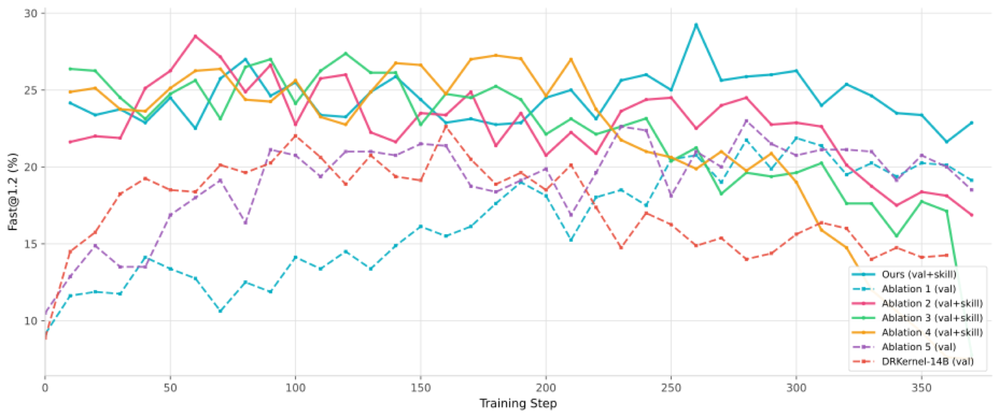

# Kernel Agent RSI：模型训练、经验内化与训练流程自改进

模型训练可以提高 kernel 求解能力，也可以让 agent 学会选择、总结和维护经验。本专题沿这两条路线，继续讨论 agent 怎样决定下一轮训练，以及训练后的模型是否更会组织后续改进

材料按首次公开日期限定在 **2026-04-19 至 2026-10-19**，旧工作的期内修订不重新计入。下文区分 GPU kernel 实验与通用 agent 迁移，结果为作者报告，本次未运行训练或硬件复现

## 先区分训练对象与部署行为

| 路线 | 更新的参数 | 部署或下一轮怎样使用 | 代表工作 |
|---|---|---|---|
| 求解与经验使用联合训练 | Kernel policy、技能选择和总结能力 | 用训练后的模型生成 kernel，并利用技能库 | daVinci-kernel |
| 经验管理能力训练 | 选择、写入、合并、删除或修复记忆的 policy | 训练好的模型操作持续变化的外部经验库 | OPD-Evolver、MemDream |
| Agent 组织任务模型训练 | 任务模型的权重；训练方案由 agent 决定或修订 | 新 checkpoint 进入下一轮求解与评估 | SIA、iCoder |
| 团队轨迹训练共享模型 | Executor 使用的共享权重 | 更新后的模型重新担任 executor、optimizer 和 evaluator | MASS |

**“训练过经验管理模型”和“部署期间持续更新模型权重”需要分别判断**。OPD-Evolver 的 fast loop 与 MemDream 的部署阶段都保持参数固定；它们的训练贡献在于先学出更好的经验操作能力

| 工作与首次公开 | 作者单位与作者 | 直接 kernel 证据 |
|---|---|---|
| [daVinci-kernel](https://arxiv.org/abs/2606.16497)，2026-06-15 | Shanghai Innovation Institute（SII）、上海交通大学、GAIR；Dayuan Fu 等，通讯作者 Pengfei Liu（刘鹏飞） | CUDA / Triton，KernelBench |
| [OPD-Evolver](https://arxiv.org/abs/2606.17628)，2026-06-16 | NUS、复旦大学、北京大学、ByteDance；Guibin Zhang、Xun Xu 共同一作，含 Shuicheng Yan（颜水成） | 通用交互、代码 / SQL 和记忆任务，未提供 GPU kernel 实验 |
| [MemDream](https://arxiv.org/abs/2609.34545)，2026-09-28 | 悉尼科技大学 AAII；Mingfei Lu 等 | 对话记忆与检索任务，迁移到 kernel 需要重新验证 |
| [SIA](https://arxiv.org/abs/2605.27276)，2026-05-26 | Prannay Hebbar、Yogendra Manawat 等；论文未列单位，Hexo Labs 按[首作者项目页](https://prannayh.com/)标注 | H100 上的 TriMul 单一工作负载 |
| [iCoder](https://arxiv.org/abs/2609.29626)，2026-08-28，按原文首发标注 | 上海交通大学、NUS、DP Technology、Endless Frontier；Cheng Yang 等，顾问含 Junchi Yan、Shuicheng Yan、Weinan E，通讯作者 Linfeng Zhang、Qibing Ren | KernelBench、TritonBench-G，与 RTL 共同训练 |
| [MASS](https://arxiv.org/abs/2610.12176)，2026-10-08 | Sakana AI、UC Berkeley；Hyunin Lee 等，含 Matei Zaharia、Somayeh Sojoudi、Yujin Tang | 开放式研究任务，尚无直接 kernel 实验 |

## daVinci-kernel：选择、执行和总结共享权重

[方法 §3](https://arxiv.org/html/2606.16497v3#S3)让同一个模型以不同 prompt / tool 扮演 selector、policy 和 summarizer。三个角色分别估计 advantage，以 REINFORCE 联合更新共享参数，训练同时更新外部技能库

| 环节 | 数据与训练信号 |
|---|---|
| SFT cold start | 从多轮 kernel 轨迹构造技能总结、技能选择及 kernel 生成数据；总结数据先形成初始库，再构造带已有技能的示范 |
| 数据多样性 | Skill embedding 用 HDBSCAN 聚类，总结数据每簇最多保留两个样本；选择数据去掉同簇重复技能，避免通用技能占满训练集 |
| Selector RL | BM25 召回 top 20，模型最多选 3 个；选择方案的 reward 来自该方案下 policy 的执行回报，使用 LOO advantage |
| Policy RL | 每任务 3 个技能方案加 1 个空技能方案，各采 4 条 rollout，最多 5 轮；16 条轨迹共同构成 TRLOO 分组 |
| Summarizer RL | 从显著改进的轨迹提炼技能，在原任务追加该技能重跑；执行验收结果形成总结角色的训练信号 |

新技能要求首轮 speedup 至少达到 `max(1.2, 1.2 × 原首轮 speedup)` 才入库。它确认的是来源任务上的增量作用；当前库的更新以追加为主，未提供按效用删除、改写旧技能的完整机制

### 参数变化、技能注入与训练稳定性

[Table 2](https://arxiv.org/html/2606.16497v3#S4.SS3)的 14B KernelBench Fast₁ 对照为

| 设置 | L2 | L3 |
|---|---|---|
| 完整方案 | 70.6% | 32.2% |
| 相同完整训练，推理时移除技能 | 49.8% | 11.5% |
| 仅使用 policy RL loss | 63.7% | 20.0% |

<!-- 图源：https://arxiv.org/html/2606.16497v3/training_curves.svg；原图转为 PNG，未改动图中数据 -->

Figure 3 中完整方案从最早记录的 checkpoint 起已在高位，随后主要波动；带 skill 的几个消融逐步退化。曲线更支持训练稳定性，尚难单独证明经验持续积累带来持续提升。完整训练后移除技能的成绩也说明，参数内化程度与推理时借助外部技能的收益还需分别验证

## OPD-Evolver：把经验管理也变成蒸馏目标

[方法 §3](https://arxiv.org/html/2606.17628v1#S3)在同一 policy 中训练 selection、execution、writing 和 maintenance。Fast loop 在固定参数下读写 `trajectory / tip / skill / tool` 四类记忆，每 30 个任务执行一次 `lookup / merge / delete` 维护；slow loop 再将这些行为与任务结果转成训练信号

### 经验价值怎样形成监督

对同一任务组，只比较某条经验已经被召回时，“被选用”和“未被选用”的回报差，再乘以使用可靠性、累计使用置信度和记忆类型权重，形成价值分数 `V(m)`。这是基于观察轨迹的归因启发式，选择偏差仍需消融或干预验证

[Privileged hindsight 蒸馏](https://arxiv.org/html/2606.17628v1#S3.SS3)为同一个模型构造两种信息视图

| 能力 | Student 可见 | Teacher 额外可见 |
|---|---|---|
| Selection | 任务与召回候选 | 候选经验的后续价值分数 |
| Execution | 任务，训练内化时不提供经验 | 有用经验与成功轨迹 |
| Writing | 当前任务、轨迹、回报与选用经验 | 新写条目后续是否有用 |
| Maintenance | 当前仓库、历史与维护工具 | 经验价值、使用次数、置信度与冗余诊断 |

Student 先按部署条件采样，teacher 在相同 student prefix 上输出 token 分布；训练最小化全词表的 `KL(teacher || student)`，teacher 分支 stop-gradient。训练后的 student 回到 fast loop，部署时不需要那些事后标签

### 消融与实现边界

[Table 3](https://arxiv.org/html/2606.17628v1#S4.SS1)报告 OPD-Evolver-4B 的 InterCode 结果

| 设置 | Bash | SQL |
|---|---|---|
| 完整方案 | 36.16 | 45.86 |
| 移除 slow evolution | 32.14 | 39.17 |
| 移除 maintenance | 35.30 | 43.51 |

它直接回答“怎样训练模型选择、总结和维护经验”，还需要 kernel 执行反馈的专门实验。评测从空经验库开始，测试流中的积累与训练阶段权重学习是不同变量

[官方实现的 Training 说明](https://github.com/bingreeky/opd-evolver/blob/8e563eda420581043132a69be50241bfe05e881a/README.md#training)明确只提供 executor OPD 的小规模示范路径；完整 selector / reflection 组件及 slow–fast 联合训练日程未包含，不能将仓库入口等同于完整复现

## MemDream：训练记忆修复策略，部署时更新外部图

[训练方法 §3.3](https://arxiv.org/html/2609.34545v1#S3.SS3)使用共享 Llama-3.1-8B 底座与三个独立 LoRA adapter。训练对象是 Dreamer、Analyst 和 Consolidator，主回答模型可保持固定

| 阶段 | 数据或 reward | 更新谁 |
|---|---|---|
| SFT | GPT-4.1 生成的 probe、诊断和修复示范，基于 MSC 对话数据 | 三个 adapter |
| 独立 GRPO | Dreamer 看 probe 区分度及覆盖；Analyst 看诊断可执行性与结构；Consolidator 看 QA-F1、覆盖、时间线和简洁性 | 各角色按各自 reward 更新 |
| 联合训练 | 新 dream queries 上，修复前后的平均检索 F1 增量 | Dreamer 与 Consolidator，Analyst 冻结 |

Consolidator 执行 `extract / synthesize / merge / prune`。Prune 将节点检索权重乘以固定系数 `0.2`，后续相关性恢复时可升权。训练学习修复行为，衰减系数和 reward 项权重仍是预设规则；不能将全部遗忘机制都归为模型学习

### GRPO 与可恢复遗忘分别有什么证据

[Table 6](https://arxiv.org/html/2609.34545v1#S4.SS3)使用固定 GPT-4.1 reader，在 LoCoMo 上比较

| 设置 | 平均 F1 |
|---|---|
| 完整方案 | 55.14 |
| Consolidator 保留 SFT 权重，移除 GRPO | 52.98 |
| `w/o Decay`，prune 改为永久删除 | 41.04 |

最后一行比较的是硬删除与可恢复降权。训练全部在部署前完成，部署期间参数固定，只修订外部记忆。Probe 的预期答案来自已存内容，因此修复检索成功不等于核实原知识真实性；迁移到 kernel 时应接入独立执行验证

## SIA：Feedback-Agent 决定何时更新任务模型

[方法 §5](https://arxiv.org/html/2605.27276v2#S5)让 Feedback-Agent 读取 scaffold、完整工具调用轨迹及评测结果，选择修改 harness，或固定 harness 后运行参数训练。任务模型为 gpt-oss-120b，LoRA rank 32；Feedback-Agent 本身的权重更新未被展示

原文在 TriMul 上采用 entropic advantage weighting，根据 reward 给 rollout 分配训练权重，并自适应控制温度以避免梯度集中到极少样本。训练由 H100 / Modal 基础设施执行，agent 组织已有训练组件；算法选择的系统性对照仍不足

[TriMul 结果](https://arxiv.org/html/2605.27276v2#S6.SS3.SSS2)需要保留两个不同基线

| 设置 | Runtime |
|---|---|
| SIA-H，仅更新 harness | 12,483 μs |
| SIA-W+H，联合使用两种更新 | 1,017 μs |
| 作者引用的 prior SOTA | 1,161 μs |

完整方案相对两者分别降低约 91.9% 和 12.4%。这是单一 kernel 工作负载的结果，仍需未见算子与同总预算对照；当前证据支持任务模型训练的价值，对 Feedback-Agent 是否更会继续训练下一代模型，还需另测

## iCoder：由执行结果决定训练方向，经验决定 token credit

[方法 §3–4](https://arxiv.org/html/2609.29626v1#S3)以专家提供的 Research Skills 固定目标、阶段和权限边界，agent 组织可执行数据池、SFT、on-policy self-distillation（OPSD）与 RLVR，训练 Qwen3.6-27B。参数确实更新，研究流程仍包含明确的人类先验

### OPSD 中最值得拆解的训练信号

Student 在 bare prompt 下 rollout；teacher 额外读取经泄漏检查的任务修复计划，以及成功前各轮失败回答和粗粒度 verifier 反馈，成功答案不进入该 privileged context

[最终更新规则 §4.3](https://arxiv.org/html/2609.29626v1#S4.SS3)先冻结并预计算 teacher scores，再执行验证、构造带符号 advantage，并使用 clipped importance-weighted update

| 信号 | 负责什么 |
|---|---|
| Verifier outcome | 编译失败为 −1，执行但错误为 −0.5；正确回答再按 log speedup 构造性能项，经同题分组中心化后决定强化或抑制的方向 |
| Privileged teacher gap | 构造正值、有界的 token multiplier，保持 advantage 符号，只重新分配 token credit |

这避免直接把“teacher 更偏好哪些 token”当作环境正确性的替代信号

| Table 6，OPSD 阶段 | SFT | B0：teacher gap 决定方向 | B1：仅执行结果 | B2：执行方向加 teacher credit |
|---|---|---|---|---|
| KernelBench L2 correct | 53% | 43% | 56% | 60% |
| KernelBench L3 correct | 8% | 4% | 9% | 14% |

B2 在 L1 的 correct 从 B1 的 44% 降到 40%，因此不同难度的收益还需分开看。此表是 OPSD 信号对照，最终 iCoder 还包含后续 RLVR。它展示 agent 调整训练方案的工程实例；更强模型能否稳定设计出更好的下一轮训练流程，仍需多代对照

[公开仓库](https://github.com/bingreeky/iCoder/blob/77d52582ad3657c410e3dcee33abfb558c1096a4/README.md)目前提供 Research Skills、evaluation harness 和模型入口，完整训练基础设施未包含

## MASS：把团队经验训练进共享模型，再复用到优化与评估角色

[MASS 方法](https://pub.sakana.ai/mass/)让同一模型担任 executor、workflow optimizer 和 evaluator。内循环保持权重固定，搜索团队角色、contract 与调用顺序；外循环从获选团队的执行轨迹更新共享模型

| 训练环节 | 原文设置 |
|---|---|
| 数据产生 | 每个任务运行 champion workflow 18 次 |
| 自评选择 | 当前模型做 pairwise workspace 比较，Bradley–Terry 排序，最多保留 15 条训练轨迹及 1 条验证轨迹 |
| 训练目标 | 从 orchestrator 初始 prompt 移除 workflow 文本，用 orchestrator 与 subagent 的输出做 LoRA SFT；任务和工具结果作为上下文 |
| 下一轮 | 更新后的模型重新担任三个角色，实验覆盖两个完整循环 |

训练数据主要监督执行角色，optimizer 与 evaluator 的变化依靠共享权重产生角色迁移。[外部评估](https://pub.sakana.ai/mass/)不进入训练闭环；固定底座 executor 后执行第一轮搜索的 workflow，报告胜率 64%。不过 workflow 搜索时三个角色同时变化，optimizer 的独立贡献仍未隔离

四个研究 benchmark 的 score / output token 为底座的 1.2–1.6×，该指标不包含搜索与训练的总成本，且尚无 kernel 实验。迁移到 KernelGen 时，可优先固定外部执行 verifier，研究共享训练是否改善下一轮的搜索与经验管理

## 对 KernelGen 的实验取舍

以下为本专题提出的实验，尚未执行。先验证训练得到什么，再检查多轮迭代是否继续受益

| 实验 | 固定什么 | 判断什么 |
|---|---|---|
| 冻结权重与冻结技能库的四组组合 | 相同初始 checkpoint、技能库、任务顺序与总预算 | 参数训练、外部积累与二者交互各贡献多少 |
| 训练后移除 / 打乱技能上下文 | 相同模型、问题与采样预算 | 能力有多少进入参数，哪些仍依赖正确检索 |
| 训练维护 policy vs 规则维护 | 相同经验来源、初始库、写入和检索预算 | 学习选择、合并、撤销是否改善后续未见任务 |
| 新旧 improver 分别训练同一底座 solver | 同一训练数据、GPU 时间和 verifier | 新模型是否更会提出和接受下一轮改进 |

Correctness 使用新鲜并行 Correct@8，避免用历史累计 best 代替；性能在正确 case 上比较，并报告逐任务退化。总成本包含 rollout、compile / test、技能验收、经验整理和梯度更新，终测反馈不回流训练

**训练出更强的 kernel solver、训练出更会管理经验的模型、证明它更会继续改进自己，分别需要对应的对照**。KOPE 保持参数固定，其 Memory Graph 与上下文管理可作为外部经验路线的对照，机制见[主调研](main.md#kopememory-graph-与-active-context-management)

## 可继续检查的实现与本地材料

| 工作 | 固定入口或公开材料 | 实现覆盖边界 |
|---|---|---|
| daVinci-kernel | [训练说明](https://github.com/GAIR-NLP/daVinci-kernel/blob/9ba953acc591028ff4f073c6f9f62f56a5ef66d3/davinci-kernel/README.md)、[技能数据流](https://github.com/GAIR-NLP/daVinci-kernel/blob/9ba953acc591028ff4f073c6f9f62f56a5ef66d3/davinci-kernel/kernel/skill/skill_data_flow.md)；`9ba953a` | 可检查训练角色、技能快照与数据组织，本次未运行训练 |
| OPD-Evolver | [Training](https://github.com/bingreeky/opd-evolver/blob/8e563eda420581043132a69be50241bfe05e881a/README.md#training)；`8e563ed` | Executor OPD 示范路径与模型入口；完整联合训练流程未包含 |
| MemDream | [论文 §3.3 与附录 D](https://arxiv.org/html/2609.34545v1#A4) | 可核对角色 reward、LoRA 与训练阶段；本次未确认专用完整官方代码入口 |
| SIA | [论文 §4.3、§5、§7.3](https://arxiv.org/html/2605.27276v2) | 可核对 LoRA、训练基础设施及算法选择描述；本次未确认专用完整官方实现 |
| iCoder | [仓库说明](https://github.com/bingreeky/iCoder/blob/77d52582ad3657c410e3dcee33abfb558c1096a4/README.md)；`77d5258` | Research Skills 与评测组件公开，完整训练基础设施未包含 |
| MASS | [reproduction notes](https://github.com/SakanaAI/mass/blob/fb403581bed2c974b3f99e7236224169da643079/docs/reproduction.md)、[experiment coverage](https://github.com/SakanaAI/mass/blob/fb403581bed2c974b3f99e7236224169da643079/docs/experiment_coverage.md)；`fb40358` | Release 与论文选择规则存在差异，部分完整 benchmark runner 与历史预算未包含 |

原有[第一人展示稿](speaker1.md)讨论经验积累、筛选与遗忘；本专题补充参数更新与训练信号，不将通用 agent 的结果直接当作 GPU kernel 收益
