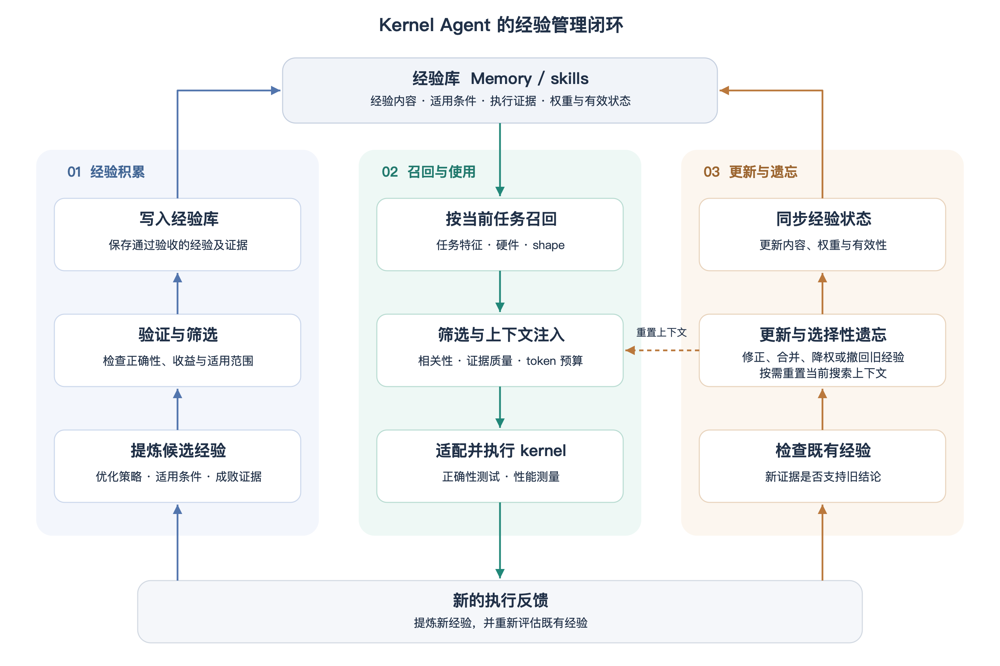
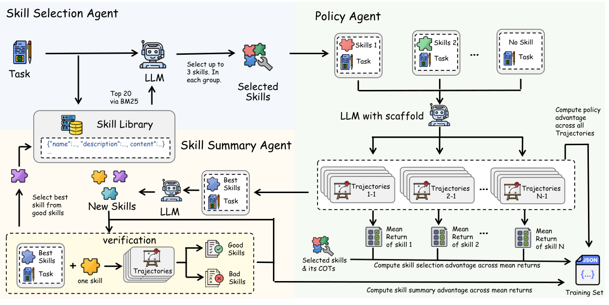
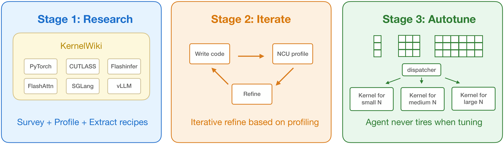
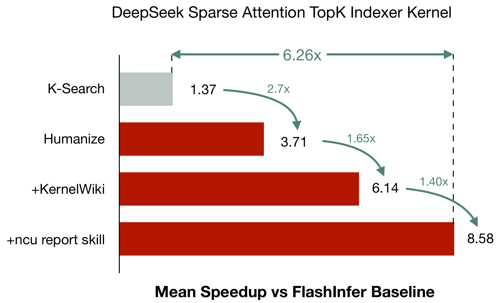
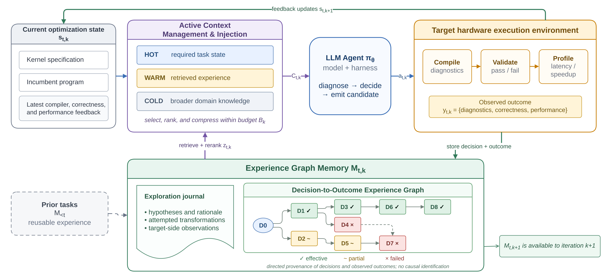
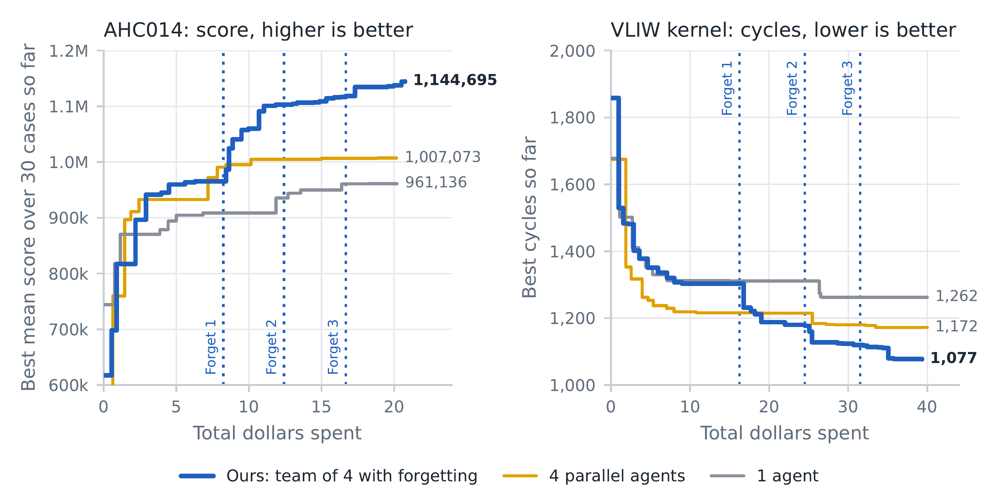
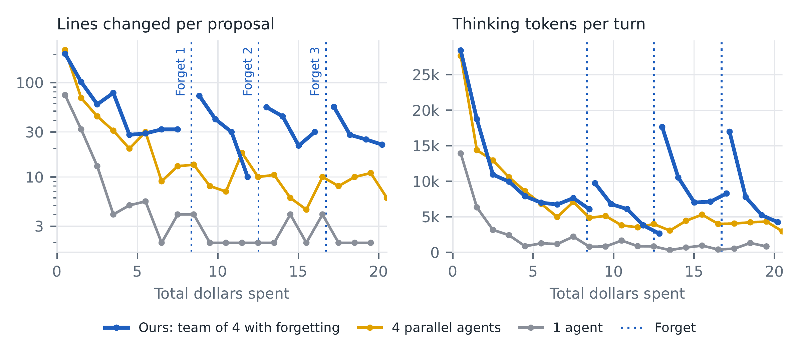
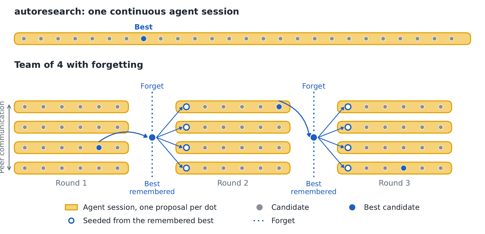
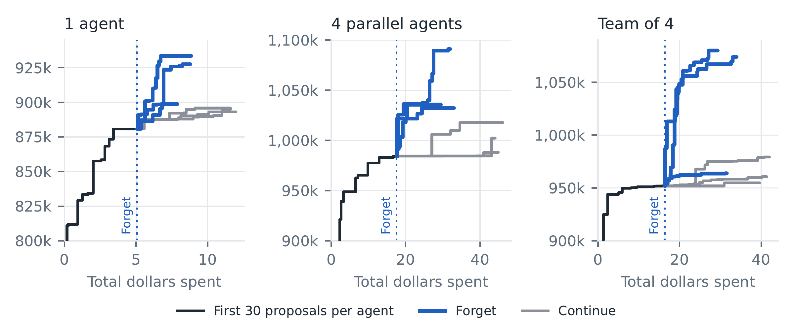
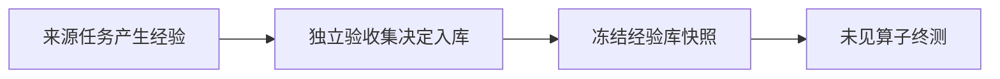

# Kernel Agent RSI：经验的积累、筛选与遗忘

经验管理要决定哪些历史继续进入上下文、哪些应当被召回，哪些经验已经失效、哪些暂时降权

本文档涉及的论文与工程材料：

| 材料 | 发表时间 | 作者单位 / 维护方 | 本次关注的问题 |
|---|---|---|---|
| [daVinci-kernel](https://arxiv.org/abs/2606.16497) | 2026-06-15 | Shanghai Innovation Institute（SII）、GAIR | 怎样联合训练技能选择、kernel 生成和技能总结 |
| [NVIDIA：KDA² / KDA v0.6](https://nvlabs.github.io/kda/blog/2026-09-27-kda-for-kda/) | 2026-09-27 | NVIDIA Agentic, MIT Han Lab | 知识怎样总结、筛选、更新与撤回，公开机制还有哪些缺口 |
| [KOPE：Beyond Scaling](https://arxiv.org/abs/2608.25570) | 2026-08-26 | 香港城市大学、华为 | Memory Graph 怎样记录决策与结果，active context 怎样按预算筛选，再检查跨硬件迁移 |
| [Scaling Discovery Requires Forgetting](https://arxiv.org/abs/2610.20563) | 2026-10-14 | UC Berkeley、Stanford | 同一任务内累积的历史，何时应从下一轮搜索中移除 |

---

# 1. 经验的积累、召回与遗忘

经验管理覆盖从执行反馈到后续使用的完整过程：提炼并验收经验，按当前任务召回候选，再根据适用条件、证据质量和上下文预算筛选；新反馈还要用于修正旧结论、调整权重或撤回失效经验

<!-- 本文分析框架示意；可编辑源图：assets/experience-lifecycle.svg -->

<!-- 上图是本次分享采用的分析框架，具体系统覆盖其中不同环节

遗忘可以发生在不同层面：从当前搜索上下文中移除历史，降低某条经验的召回权重，或将失效经验标记为不可用。是否继续保存原始记录，是另一个独立的管理决策

| 积累对象 | 保存的内容 | 后续怎样使用与管理 |
|---|---|---|
| Memory / skills | 优化思路、适用条件、成功与失败证据 | 召回、筛选后注入上下文，根据新证据修正、降权或撤回 |
| 可执行实现与工具 | kernel 范例、分析工具、数值检查 | 适配并重新验证，更新适用条件与可用状态 |
| 模型权重 | 技能选择、使用与总结能力 | 通过训练改变后续决策 |

**本部分检验积累、召回与遗忘怎样影响后续求解；改进者继续自我改进的能力，需要独立实验** -->

---

# 2. daVinci-kernel

## 联合训练技能选择、使用与总结

该工作由 SII、GAIR 团队完成

[daVinci-kernel](https://arxiv.org/html/2606.16497v3#S3)让三个角色共享同一 LLM 权重，分别组织训练信号，联合更新模型与技能库

<!-- 图源：[daVinci-kernel，Figure 2](https://arxiv.org/html/2606.16497v3#S3.F2)，使用论文原图 -->

| 角色 | 接收什么 | 学习信号 |
|---|---|---|
| Selector | 任务与候选技能摘要 | 所选方案下的 policy 回报 |
| Policy | 任务与技能正文 | 多轮执行 reward，使用 5-turn TRLOO |
| Summarizer | 已有技能、首轮与最佳实现 | 候选技能经执行验收后的收益 |

<!-- 角色数据组织可以继续检查[公开实现的数据流说明](https://github.com/GAIR-NLP/daVinci-kernel/blob/9ba953acc591028ff4f073c6f9f62f56a5ef66d3/davinci-kernel/kernel/skill/skill_data_flow.md)：selector 读取技能摘要，policy 读取正文，summarizer 同时看到已有技能，便于提炼增量发现 -->

## 新技能怎样获得入库资格

<!-- 按照[论文的配置与验收规则](https://arxiv.org/html/2606.16497v3#S3.SS5)， -->
对于效果好的 trajectory，发给 summarizer 来总结成 skill。Summarizer 生成的候选 skill 还要注入来源任务重跑，确认它能改善首轮生成

$$
r_{\mathrm{verify}} \geq \max(1.2,\;1.2\,r_1)
$$

$r_1$ 为原轨迹首轮 speedup，$r_{\mathrm{verify}}$ 为保留已有技能、追加候选技能后的首轮 speedup

| 环节 | 论文设置 |
|---|---|
| 检索 | BM25 召回前 20 个，LLM 最多选 3 个技能 |
| 采样 | 3 个技能方案加 1 个空技能方案，各 4 条 rollout |
| 验收位置 | 产生该技能的原任务 |

来源任务验收确认局部增量收益，跨任务可用性需要另外测量

**召回与二次筛选**：BM25 先做粗召回，索引由 skill 的 `name / description / tags / content` 拼接而成，取前 20 个候选；LLM 再根据当前任务和候选技能摘要筛选，最多选 3 个，随后将所选 skill 的正文注入 Policy

**Memory 的形式**：经验保存为结构化 skill，按训练 step 写成 `global_step_N.jsonl` 快照，每行一个 JSON 对象。论文 §3.2 定义五个主要字段，公开实现还保存验收 speedup

| 字段 | 保存什么 |
|---|---|
| `name` | 技能标识，同一快照内唯一 |
| `description` | 一句话说明优化方法与适用场景，供 Selector 筛选 |
| `scope` | 技能适用的 kernel 类别 |
| `tags` | 检索与分类关键词 |
| `content` | Markdown 正文，包含优化思路、代码片段和使用注意事项，供 Policy 使用 |
| `verify_speedup` | 候选 skill 注入来源任务后，验收得到的首轮 speedup |

**局限：经验库只做 append，缺少旧经验的删改与遗忘机制**。写入逻辑保留全部已有条目，再追加验收通过的新 skill；同名条目通过加后缀另存。它有入库筛选和召回筛选，但没有对已入库经验做内容修订、语义合并、降权、过期淘汰或删除的机制；本轮未选中某条经验，也不会改变它在库中的状态

<!-- 实现中还有一个值得保留的工程点：[技能库按训练 step 保存 JSONL 快照](https://github.com/GAIR-NLP/daVinci-kernel/blob/9ba953acc591028ff4f073c6f9f62f56a5ef66d3/davinci-kernel/kernel/skill/skill_library.py)，把模型 checkpoint 与当时可用的经验对应起来，便于恢复和归因 -->

<!-- ## 消融能回答什么

[论文 Table 2](https://arxiv.org/html/2606.16497v3#S4.SS3)报告了下面的 14B 结果，指标为 KernelBench Fast₁，即满足 correctness 且 speedup 至少达到 1× 的任务比例

| 设置 | L2 Fast₁ | L3 Fast₁ |
|---|---|---|
| 完整方案 | 70.6% | 32.2% |
| 完整训练，推理时移除技能 | 49.8% | 11.5% |
| 仅使用 policy RL loss | 63.7% | 20.0% |

结果支持技能注入的作用，也支持联合训练三个角色相对于只训练 policy loss 的价值 -->

## Figure 3：维持表现的证据强于持续提升

完整方案从最早记录的 checkpoint 起就处于高位，后续主要在相近水平波动；带 skill 的 Ablation 2 / 3 / 4 则在后期逐步退化。
因此，从这个消融实验看，更支持联合训练有助于维持表现，对“经验持续积累使系统不断变强”的支持较弱
<!-- 。此外，模型权重与技能库同时变化，图中也缺少冻结初始技能库的对照，难以单独判断新增 skill 的收益 -->

<!-- 图源：https://arxiv.org/html/2606.16497v3/training_curves.svg；原图转为 PNG，未改动图中数据 -->

<!-- Figure 3 展示 14B 模型的验证集 Fast₁.₂，衡量满足 correctness 且 speedup 达到门槛的任务比例 -->

| 曲线（颜色与线型） | 训练设置 |
|---|---|
| Ours | 完整方案：SFT 多样性过滤，三个角色联合 RL |
| Ablation 1 | 与完整方案相同，只在验证时移除 skill |
| Ablation 2 | SFT 去掉多样性过滤，RL 仍采用完整方案 |
| Ablation 3 | 仅计算 Policy 的 RL loss，三个角色仍使用更新后的共享模型 |
| Ablation 4 | 同 Ablation 3，技能选择改为纯 BM25，去掉 LLM 精排 |
| Ablation 5 | 训练与推理均去掉技能库，仅做 Policy RL |
| DRKernel-14B | Dr. Kernel-14B 对照模型 |

<!-- | 原图中的趋势 | 本次分享的判断 |
|---|---|
| 完整方案从最早记录的 checkpoint 起就处于高位，之后主要在相近水平波动 | 缺少随训练持续提高的清晰趋势，单次峰值也不足以证明持续增长 |
| 带 skill 的 Ablation 2 / 3 / 4 早期表现相近，后期逐步下降 | 最终差距更多体现完整方案维持了表现、减轻了退化 |
| 不注入 skill 的 Ablation 1 整体有所上升 | 部分能力可能被内化，不能概括为所有消融都只是在退化 | -->

<!-- **这张图更支持联合训练的稳定性，对“skill 持续积累使完整系统不断变强”的支持较弱**。模型权重与技能库同时变化，还需训练前基线和冻结初始技能库的对照，才能判断新增 skill 的净贡献

本次分享据此提出进一步问题：固定模型权重，只更新技能库，未见算子还能获得多少收益；Fast₁ 也应与新鲜并行 Correct@8 分开报告 -->

---

# 3. KDA / KernelWiki：经验怎样总结、更新与撤回

KDA 同时使用两层经验：
- KernelWiki：保存跨任务复用的知识，帮助决定可以尝试哪些优化方向
- 任务工作区：保存当前探索产生的候选、结果与失败原因，帮助判断哪些尝试值得继续

先从 KernelWiki 取用经验，再结合 profiling 迭代实现，最后针对不同 shape 调参

<!-- 图源：KDA 官方技术报告 Figure 3；官方仓库原图：https://raw.githubusercontent.com/mit-han-lab/mlsys2026-flashinfer-contest/d61573ffb2008b6e68fb32fe8e17703e4b2448c9/docs/assets/3_stage_pipeline.png；原图未修改 -->

<!-- [KDA v0.6](https://nvlabs.github.io/kda/blog/2026-09-27-kda-for-kda/)来自 NVIDIA Agentic CUDA Effort，作者 Dongyun Zou 等，含 Zihao Ye、Junru Shao、Ligeng Zhu；KernelWiki 由 MIT Han Lab 仓库维护，并作为 KDA 的 skill 接入。以下按 [KernelWiki 公开快照](https://github.com/mit-han-lab/KernelWiki/blob/b6b4301f15e8ce6955a56776690643ce5db369e6/README.md)说明机制，其部署版本与博客中的内部 wiki 分开看 -->

## 跨任务记忆：KernelWiki

### 规模

KernelWiki 已开源，内容以来源材料为主，归纳后的知识层相对精简

| 内容 | 规模 |
|---|---|
| 综合知识页 `wiki/` | 52 篇，Markdown 合计约 124 KiB |
| PR 来源页 | 944 篇，覆盖 10 个仓库 |
| 文档摘要 | 16 篇 |
| 博客摘要 | 22 篇 |
| 竞赛材料 | 7 篇 |
| 知识页与来源页合计 | 1,041 篇 |
| 整个仓库下载包 | 约 5.4 MiB |
| 解压后文件体积 | 约 24 MiB，不含 Git 历史 |

<!-- 规模统计：2026-10-19，mit-han-lab/KernelWiki 主分支 b6b4301f15e8ce6955a56776690643ce5db369e6；按 Git 文件树与该提交的源码归档统计；来源页 989 篇 + 综合知识页 52 篇；仓库包含代码附件、工具和审核记录 -->

### 保存什么：带适用条件的知识页

KernelWiki 从已有生产实现、PR、文档和竞赛案例中整理优化知识，供不同任务检索复用；使用过程中还会纠错、补充和调整条目

知识分为 `sources/ → wiki/ → queries/`：先保存上游 PR、文档、博客等证据，再综合成技术、症状诊断与 kernel 案例，最后从元数据生成检索索引

| 知识页信息 | 用途 |
|---|---|
| `architectures / tags / prerequisites` | 限定硬件、技术与使用前提 |
| `confidence / reproducibility` | 区分证据等级和代码复现程度 |
| `sources`、代码摘录与适用限制 | 让使用者能核对原始实现，并判断是否能迁移 |

例如 Ping-Pong Scheduling 除双 tile 交替计算的思路，还写明独立存储、barrier phase、覆盖时序和额外资源开销。**公开了总结结果与字段，还缺少任务结束后自动总结经验的 writer prompt、触发条件和入库验收协议**

### 怎样构造：从材料收集到知识页

**收集材料 → 规则筛选 → 保存来源页 → 归纳知识页 → 生成索引并校验**，后续再审核和修正内容。PR 是脚本化处理最明确的入口，文档、博客和竞赛材料也会进入来源层，供知识归纳使用

| 步骤 | 具体做法与产物 | 规则还是模型 | 使用的模型 |
|---|---|---|---|
| 1. 收集 PR 候选 | 按配置好的仓库、关键词和截止日期搜索 merged PR，抓取正文、changed files 与 diff，登记候选 | GitHub API + Python 脚本 | 不调用 LLM |
| 2. 筛选候选 | 按文件路径、后缀、patch 中的 device / DSL kernel 实现信号判断是否入库，记录接受或排除原因；证据获取失败时暂缓处理 | 规则判定 | 不调用 LLM |
| 3. 生成 PR 来源页 | 将上游正文摘录、变更文件、架构与标签等填入固定模板，保存为 `sources/prs/...md`；已有页面默认跳过 | 模板生成 + 元数据规则 | 不调用 LLM |
| 4. 归纳知识页 | 扫描来源材料，发现未覆盖的优化概念，综合成技术、诊断与 kernel 案例，新增或补充 `wiki/` 页面 | 语义归纳与撰写；人和 LLM 的分工未说明 | 未说明具体写作模型，也未公开完整的自动生成流程 |
| 5. 生成索引与校验 | 从页面的 YAML frontmatter 生成 `queries/` 索引，检查字段、标签、引用和证据要求 | Python 脚本 + 规则校验 | 不调用 LLM |
| 6. 后续内容审核 | 检查事实、架构归类与数值，发现问题后修正页面、规则和测试，再重新校验 | LLM 审阅 + 脚本复核 | 审核记录中有 `claude-opus-5`，也有 `claude-opus-5[1m]` 扩展上下文版本 |

**模型信息的缺口主要在第 4 步**：后续审核用的模型已有记录，最初把材料写成知识页用了哪个模型仍未说明

<!-- 构造流程：KernelWiki b6b4301 的 scripts/refresh_candidate_ledger.py、scripts/pr_policy.py、scripts/generate-pr-pages.py、scripts/generate-indices.py、scripts/validate.py；知识归纳计划：https://github.com/mit-han-lab/KernelWiki/blob/b6b4301f15e8ce6955a56776690643ce5db369e6/data/plan-supersession-baselines/plan-phase2.body.md；审核模型：https://github.com/mit-han-lab/KernelWiki/blob/b6b4301f15e8ce6955a56776690643ce5db369e6/audit/unverified-claims.md -->

`verified` 条目要求 official-doc 与 upstream-code 两类证据。结构校验确认来源字段和引用齐全，经验在新任务上是否有效仍需运行验证

### 怎样选用和更新

检索脚本采用规则：先做别名扩展，按架构、语言、症状和置信度过滤，再按关键词命中排序；每个词标题命中加 10 分、元数据加 5 分、正文最多加 3 分。脚本没有内置 LLM reranker

新来源沿上述流程补充进来，旧知识页需要另行复核改写，再重建索引。版本记录保存适用范围、上次验证版本与日期，由脚本对陈旧条目告警，不会自动删除

### 怎样遗忘：纠错与撤回

维护过程中，缺乏依据的模型 PR 总结被替换为上游摘录、路径与 hash，错误架构标签被重算，无依据的数字与来源不实的代码被移除或收窄

一个具体例子是 Ping-Pong 页原先关联了无关的 CUTLASS backward-attention 文件，维护时删除了该“完整实现”并保留说明。撤回原因、日期与原资产路径仍被保留，旧文件可从 Git 历史恢复

可确认的是**知识内容可纠正、可撤回，并保留出处**。自动根据经验使用收益决定保留或淘汰，以及任务失败怎样触发知识修订、重新验收并采用，公开材料仍不完整，不能直接认定已有自主持续学习闭环

## 任务内记忆：探索记录与执行证据

Agent 在当前任务中不断产生新经验：某个改动是否正确、在哪些 shape 上加速、瓶颈怎样变化、哪些分支已经失败。这些内容保存在任务工作区，推荐采用下面的文件布局

| 记录 | 保存什么 | 后续怎样使用 |
|---|---|---|
| `docs/draft.md`、`docs/plan.md` | 初始判断、待尝试方向、执行计划与验收标准 | 组织后续探索，检查目标是否完成 |
| `candidates.jsonl` | 候选名称、父子关系与状态 | 回看从哪个版本修改而来，比较不同分支 |
| `benchmark.csv` | 各候选的性能测量结果 | 比较收益，决定保留或继续修改哪个候选 |
| `profile/` | Nsight Compute 报告与分析摘要 | 根据实际瓶颈决定下一步优化 |
| `runs/`、`outputs/` | 生成的实现、运行结果等产物 | 恢复候选，复查或重跑实验 |

每轮先验证 correctness，再测量性能，将证据与候选关联，决定接受、修改还是拒绝。拒绝候选时也要记录原因，后续探索可以据此回溯失败，减少重复尝试

**这一层保存的是具体任务的探索历史**，主要支持当前任务继续优化、恢复和接手。放弃某个候选会改变它的状态，同时保留失败记录；工作区约定没有定义统一的历史压缩、自动降权或删除策略

<!-- 探索记录与工作区约定：https://github.com/NVlabs/kda/blob/acdd79343c5e9d0c7cb96289f26fd3f1051ce785/docs/agent-flow.md；执行要求：https://github.com/NVlabs/kda/blob/acdd79343c5e9d0c7cb96289f26fd3f1051ce785/prompts/basic-flow.md -->

## 两层记忆怎样衔接

KernelWiki 提供优化方向，任务内的执行证据检验这些方向在当前 kernel、硬件与输入上的效果。**任务内记录进一步提炼成通用经验、通过跨任务验收并写回 KernelWiki，这一步的自动流程仍未清楚展开**。因此，要分别看待任务内经验积累、跨任务知识维护，以及两者之间的经验沉淀

## 结果怎样读

- **K-Search**：LLM 先规划优化策略，再生成具体实现，根据执行反馈调整搜索树中各方向的优先级，并剪去无效分支
- **Humanize**：通过 Claude Code 插件组织“计划—实现—独立审查”循环。先确定验收标准，Claude Code 实现和测试，Codex 独立检查结果，未通过就继续修改

图中先比较 K-Search 与 Humanize 两种工作流，后两行再依次向 Humanize 加入 KernelWiki 和 ncu-report-skill

<!-- 基线方法说明：K-Search https://arxiv.org/html/2602.19128v2#S3；Humanize https://arxiv.org/html/2610.08900v2#S3；图中配置对应 KDA 技术报告 Table 3 -->

<!-- 图源：KDA 官方技术报告配套仓库：https://raw.githubusercontent.com/mit-han-lab/mlsys2026-flashinfer-contest/d61573ffb2008b6e68fb32fe8e17703e4b2448c9/docs/assets/ablation_on_skills.png；对应技术报告 Table 3，原图未修改 -->

DSA TopK indexer 在 48 小时预算下接入 KernelWiki 后，speedup 从 3.71× 提高到 6.14×；动态更新和遗忘的增益还需冻结 wiki 的对照

9 月博客中的失败候选还暴露了常数替代 L2 normalization、硬编码序列边界、数值技巧超出适用范围等问题。作者用隔离分布、fresh seeds、极值检查、逐元素容差与真实模型轨迹加强验收。经验记录因此需要绑定输入条件和 verifier revision，防止把测试漏洞积累成通用 trick

Humanize（NVIDIA、UCLA、MIT、清华大学、Nunchux AI；Sihao Liu 等，含韩松、Tony Nowatzki）：系统生成了大量复盘建议，但论文没有找到这些建议与插件主干改动之间的强关联。这说明“产生反馈”到“落实改进”之间仍有缺口，但它没有提供解决这个缺口的经验管理算法

---

# 4. KOPE：Memory Graph 与 Active Context Management

KOPE 主要实验在 Ascend 910C 上优化 AscendC kernel

它把探索过程中产生的执行反馈积累成外部记忆，再用于后续尝试与任务。**GLM-5.2 和 Deepseek-V4-Pro 分别作为生成、修改 kernel 的 Agent 底座，独立运行两组评测**，模型权重保持固定；生成的 kernel 则由编译器和评测工具在 Ascend 910C 上实际执行

Experience Graph Memory 负责保存执行记录并支持检索，Active Context Management and Injection 负责按预算组装 prompt，供当前配置的 LLM 使用。这两个模块是记忆与上下文机制，并不分别对应上述两个模型

<!-- 图源：https://arxiv.org/html/2608.25570v1/kope-experience-loop.drawio.svg；论文 Figure 1，SVG 转为 PNG，未改动内容 -->

## 经验怎样保存：Journal、Case 与 Graph

每次尝试都经过编译、正确性验证和性能测量。正确且更快的候选才能替换当前实现，但编译失败、结果错误和性能退化也会被保存，作为后续探索的失败经验

同一次尝试有两种记录，再通过前驱关系组成 Experience Graph Memory

| 形式 | 保存什么 | 用途 |
|---|---|---|
| Markdown Journal | 尝试的优化策略、代码改动、验证与测量，以及对结果的解释；采用 append-only 记录 | 提炼叙述摘要，支持语义检索 |
| JSON Case | 算子与输入场景、优化思路、可选 before / after code、执行反馈、correctness、speedup、confidence，以及 session、step、`prev_case_id` | 保存结构化执行结果，支持精确过滤与图排序 |
| Graph | 用 `prev_case_id` 连接当前尝试与它所基于的候选 | 保留优化轨迹、不同分支和后继表现 |

每个 Case 最多有一个前驱，可以有多个后继，因此图呈现为有向无环森林。边表示“这次修改从哪个候选出发”，能够还原探索顺序和分支

## 经验怎样召回：相关性筛选与图排序

每轮都根据当前 kernel、最新反馈和优化目标重新检索，由 KOPE-Mem / ReMe 记忆层支撑，分为以下环节

| 环节 | 方法 | 是否由模型选择 |
|---|---|---|
| 精确召回 | 按算子、优化层、思路 ID、结果标签过滤结构化 Case | 字段匹配规则 |
| 语义召回 | 从 Journal 和经验摘要中补充语义相关候选 | 论文写明使用语义检索，但没有说明编码模型、相似度算法和 top-k 等配置 |
| Graph 排序 | 根据单步收益、后继收益与 confidence 计算分数 | 固定数值公式，没有描述另用 LLM reranker |
| 上下文准入 | 按 Hot / Warm / Cold 优先级及 token cap 选入内容 | 固定预算规则 |

因此，可以确认的是**字段过滤 + 语义召回 + 图评分排序**。论文没有将召回方法写成 BM25，也没有把 GLM-5.2 或 Deepseek-V4-Pro 指定为独立的检索模型

### Graph 排序的计算

设 $a_v$ 是 Case $v$ 相对基线的绝对 speedup，先计算它相对前驱的单步收益

$$
r_v=\frac{a_v}{a_{\operatorname{prev}(v)}}
$$

根节点或前驱 speedup 非正时，取 $r_v=1$。再将单步收益与后继节点的收益合起来；终端节点按自身单步收益计分

$$
d(v)=
\begin{cases}
r_v, & \operatorname{succ}(v)=\varnothing \\
0.5\,r_v+0.35\displaystyle\sum_{u\in\operatorname{succ}(v)}d(u), & \text{其他节点}
\end{cases}
$$

$\operatorname{succ}(v)$ 是直接后继集合，后继项系数 $0.35=0.5\times0.7$，其中 $0.7$ 为折扣因子。最终分数再乘以 Case 中记录的置信度 $c_v$

$$
\operatorname{score}(v)=d(v)\,c_v
$$

相关性筛选和结果标签分组在先，这个分数用于同一结果标签、相关性相近的候选之间排序

图结构的作用主要体现在第二步：一个 Case 自身收益不大，但它的后续分支表现很好，也可能获得更高评分。它利用了历史优化轨迹中的后续结果，而不只看当前节点的 speedup；图中的边记录探索关系，不能据此认定前一步促成了后续加速

## Active Context：本轮注入哪些内容

召回的经验还要经过 token 预算筛选。KOPE 每轮重建 prompt，按 Hot → Warm → Cold 的顺序放入内容

| 层次 | 内容 | 预算安排 |
|---|---|---|
| Hot | 任务规格、当前代码、最新执行反馈与优化目标 | 优先保留必需状态 |
| Warm | 当前状态相关的 Cases、Journal 摘要和 procedural digests | 按检索排序，在 warm cap 内选入 |
| Cold | 更广泛的文档、跨类别经验与旧摘要 | 使用剩余容量，受 cold cap 限制 |

可用预算先扣除 system prompt、生成 allowance 和近期信息预留，再分配给这三类内容。被选中的经验可以表现为精简 Case 字段、before / after 代码变化、Journal 摘要或操作方法摘要；各层 cap 按配置固定，没有在线学习

同一条经验在不同任务状态下可以从 Cold 变成 Warm。分类反映它与本轮决策的关系，经验本身仍保存在外部记忆中

## 遗忘做到哪一步

**KOPE 主要控制本轮上下文中经验的可见性**：相关性低或超出预算的内容暂不注入，后续仍可重新召回。Journal 持续追加，论文没有给出按长期效用自动删除旧 Case、淘汰过时经验的完整策略

因此，这里要区分“这轮不看某条经验”和“长期撤回或删除这条经验”。前者已有明确的预算与选择机制，后者仍缺少具体方案

## 实验结果与 Graph 的局限

组件消融使用 GLM-5.2，覆盖固定的 53 个算子、1,060 个 case

| 对比项 | 对照设置 | 启用对应机制 |
|---|---|---|
| Context policy：case pass rate | Passive 60.0% | Active 84.6% |
| Context policy：总优化 token | 15.9B | 1.113B |
| Experience Graph Memory：case pass rate | 关闭 Graph Memory 55.2% | 启用 Graph Memory 84.6% |

启用 Experience Graph Memory 后，在双方都有有效计时的 412 个 case 上，几何平均加速为 1.43×。这些结果支持主动管理上下文与外部经验的作用，但还留下两个问题

- **Graph 怎样真正进入 LLM 的上下文？** 论文明确利用后继关系做检索排序，注入时主要描述 Case、代码变化和摘要；完整路径、子图、边和不同分支怎样一起提供给 LLM，没有充分展开，`prev_case_id` 是否保留在 prompt 中也不清楚
- **Graph 相比同内容的 Flat Memory 多贡献多少？** 当前消融比较整套记忆的启用与禁用，无法单独拆出记忆内容、图排序和结构注入各自的收益；Active Context 的消融也同时改变了检索、压缩和注入

进一步可以固定相同 Cases / Journals 与预算，比较“无记忆 → Flat Retrieval → Graph-aware Ranking → 图排序加 Trajectory Injection”。这能分别判断记忆、图结构排序，以及向 LLM 展示优化路径的贡献；这是后续实验建议

## 跨硬件复用：经验需要适用条件

**SpacemiT K3 是进迭时空的 RISC-V 处理器**。论文报告的 CPU 环境为 8 个 X100 核心、支持 RVV 1.0 向量扩展，配备 16 GB 内存；RVV 提供数据并行的向量运算能力。实验通过 SpacemiT 版 Triton 运行来自 FlagGems 的 kernel，以本机 PyTorch 实现为对照，四组均由 GLM-5.2 生成和优化代码

**为什么从 NPU 迁移到 CPU？** 作者希望检验 KOPE 离开 Ascend 环境后，是否仍能复用经验、从目标平台反馈中继续改进。这里同时更换了硬件（Ascend NPU → RISC-V CPU）、语言（AscendC → Triton）、编译路径和评测环境（CANN Bench → FlagGems）。Agent 为目标 CPU 重新生成实现，复用的是优化经验和工作流

从实验设计看，这可以作为硬件与软件栈差异较大的迁移测试。另一款 NPU 或 GPU 也可以用于迁移实验；**作者没有具体解释为何选 K3，也没有比较这些备选目标**

这里值得关注的是：一条经验帮助实现正确，不代表它还能帮助实现更快

| K3 使用的经验 | 通过率，分母 204 个 case | 固定 123 个共同通过 case 的 geomean speedup |
|---|---|---|
| Cold start | 60.3% | 0.388× |
| Ascend 来源经验 | 83.3% | 0.145× |
| K3 本地经验 | 89.2% | 0.514× |
| Ascend + K3 | 92.2% | 0.786× |

Ascend 经验扩大了通过范围，却使共同 case 的性能变差；加入 K3 本地经验后性能回升。表中 speedup 以目标 CPU 的原生 PyTorch 为基线，四组汇总值仍低于 1×，每配置仅有一次归档运行

这说明 Memory 需要保存硬件、软件栈和输入条件，复用时分别验证正确性与性能收益

<!-- 机制与结果：https://arxiv.org/html/2608.25570v1#Sx3.SSx2、#Sx3.SSx3、#Sx5；迁移实验：#A1.T5；图结构的独立收益与 Trajectory Injection 对照为本次分享的分析与实验建议 -->

<!-- 排序公式包含正文对 terminal Case 的说明；编码模型、相似度算法与检索 top-k 未在文中给出。K3 环境见附录 Table 4；X100 / RVV 规格：https://github.com/spacemit-com/docs-chip/blob/main/en/key_stone/k3/k3_docs/k3_ds.md；将 NPU→CPU 理解为差异较大的迁移测试是实验设计分析，具体选型原因未说明 -->

---

# 5. Scaling Discovery Requires Forgetting：保留解，重置搜索历史

<!-- 作者单位为 UC Berkeley、Stanford、Bespoke Labs，首作者 Shangyin Tan，作者还包括 Koushik Sen、Alex Dimakis、Matei Zaharia -->

实验使用 Pi Agent 和 DeepSeek V4.1 Flash，研究同一任务中的长期迭代。核心观察是：历史不断积累后，Agent 的探索越来越保守，增加轮次也难以继续取得收益

灰线为单 Agent，黄线为四个独立并行 Agent，蓝线为共享候选并周期性遗忘的四人团队，蓝色虚线标记遗忘时点。左图 AHC014 的分数越高越好，右图 VLIW kernel 的 cycles 越低越好；遗忘后，团队多次突破此前的平台期

图中横轴是累计模型费用，展示的是每种配置三次运行中表现最好的一次，未展示三次运行的均值与波动范围

<!-- Figure 1：arXiv:2610.20563v1，源码 figures/main.pdf；直接渲染为 PNG，未改动图中内容 -->

## 长会话之后，Agent 出现了什么问题

单 Agent 持续运行、多个 Agent 独立并行、团队共享候选，都可能进入平台期。后期会出现三种表现

| 表现 | 观察到的行为 |
|---|---|
| 修改越来越小 | 从较大的结构调整退到几行局部修改 |
| 推理投入下降 | 每轮 reasoning token 逐渐减少，搜索方向收缩 |
| 有想法却不做实验 | 反复判断已经到达极限，或因方案复杂、风险高而放弃实现 |

左图是每次 proposal 的代码修改行数，右图是每轮 thinking token。蓝色虚线处重置历史后，两者重新上升，随后又逐渐下降

VLIW 的三次单 Agent 实验中，大量轮次主动结束探索，没有提交新候选

| 统计项 | 结果 |
|---|---|
| 没有产生候选的已完成 turn | 532 / 763，约 69.7% |
| 这些轮次占用的模型费用 | 66.2% |
| 无候选且至多读取一个文件、没有修改代码便宣布平台期 | 531 / 532 |

一个 Agent 在达到 1710 cycles 时判断已接近机器的实际性能极限，之后仍自行降到 1644 cycles；同一任务中，带遗忘的团队最终达到 1077 cycles。它对优化空间的判断明显过早

更典型的是 selection-tree 案例：Agent 先因错误的成本估算否决一种新实现，随后纠正估算并分析了寄存器需求，却仍以复杂、风险高为由不做实验，连续 11 个 turn 没有新候选。这表明停滞可以发生在仍有新想法的时候，已有历史与判断可能让 Agent 越来越不愿行动

<!-- Figure 5：arXiv:2610.20563v1，源码 figures/analysis.pdf；直接渲染为 PNG，未改动图中内容；后期行为见论文 §5 -->

## 怎样遗忘：保留最佳解，清空两类历史

“两类历史”分别是 **Session 中的会话历史**，包括此前的消息、工具交互与推理记录；以及 **Search state 中的搜索历史**，包括历次候选实现、对应分数、judge 反馈与候选之间的演化关系。重启时同时切断这两类历史的继承，只保留最佳候选及其分数

每个 Agent 有自己的会话与搜索记录。轮内可以读取同伴的候选 commits 和分数，借用其他分支的发现；重启时，全队从同一个最佳候选出发

| 状态 | 轮次重启时怎样处理 |
|---|---|
| 当前最佳候选与分数 | 保留，所有 Agent 从它重新开始 |
| 会话历史（Session） | 启动新会话，清空此前消息、工具交互与推理记录 |
| 搜索历史（Search state） | 新工作区只提供最佳候选及其分数，隐去其他候选、分数、反馈与 lineage |
| Task 与 judge | 保持相同任务和验收目标 |

执行上由 reducer 决定下一轮能看到哪些文件、续接哪个 session。保留最佳实现，能够继承已经写进代码的有效优化；清空探索过程，则让新一轮重新考虑此前被排除的方向

<!-- Figure 2：arXiv:2610.20563v1，源码 figures/idea.pdf；直接渲染为 PNG；reducer 与两类历史见论文 §3 -->

## 遗忘的收益怎样验证

从已经停滞的同一状态出发，比较继续原会话与重启：每个 Agent 都再执行 30 次 proposal

黑线是共同的前期搜索，灰线继续原会话，蓝线重启。三个面板依次是单 Agent、四个独立 Agent、四人共享候选的团队

| 同一四人团队的后续策略 | 相对起点的分数增益，3 次重复 | 每次运行的模型费用 |
|---|---|---|
| Continue | +1.4% ± 1.3% | $24.67 |
| Forget | +9.2% ± 6.9% | $15.32 |

这是 AHC014 上同一起点、相同 proposal 数的比较。重启后上下文更短，成本下降，搜索行为也发生变化；两种作用仍可进一步拆分

同一起点的团队实验还比较了每个 Agent 后续前 10 次 proposal 的行为

| 指标，中位数 | Continue | Forget |
|---|---|---|
| 每次修改代码行数 | 6 | 40 |
| 每次 reasoning token | 2.9k | 9.4k |

重启后，Agent 恢复了较大幅度的修改，并投入更多推理。行为变化与性能改善同时出现，但实验没有单独证明增加 reasoning token 就是收益的原因

<!-- Figure 4：arXiv:2610.20563v1，源码 figures/ablation.pdf；直接渲染为 PNG；分数与费用对应 Table 3，行为统计见 §5 的同起点团队实验 -->

## 遗忘与 Communication 怎样互补

VLIW 的一个团队运行展示了新方向怎样从失败变成有效优化

| 阶段 | cycles，越低越好 | 发生了什么 |
|---|---|---|
| 遗忘前 | 1201 | 改进已缩小到每次几个 cycles |
| 遗忘后尝试大改动 | 首次 1409，第二次 1201 | 换一种树节点读取方式，先退化，再勉强回到起点 |
| 借用同伴的技巧 | 1136 | 读取同伴的代码 diff，用一个简化技巧修复新实现 |
| 该轮结束 | 1114 | 团队继续改善结果 |

在这个案例中，遗忘让 Agent 重新尝试较大的改动，Communication 则帮助它吸收同伴的技巧，修复最初失败的方案。两者分别支持新方向的探索和探索结果的继续完善

<!-- VLIW 轨迹与 selection-tree 案例均见论文 §5；协作修复的细节仅描述到借用简化技巧，未给出该技巧的具体代码机制 -->

## 对 Memory 管理的启发：最佳代码也是压缩后的经验

把“已验证产物”和“产生它的历史叙述”分开管理：最佳实现可作为下一轮起点，历史尝试和解释则可以阶段性清空。有效的优化已经写入代码，因此最佳代码本身也承载了部分历史知识

| Memory 思路 | 主要保留什么 |
|---|---|
| Experience Memory | 成功或失败的经验条目，供后续检索 |
| Graph Memory | 经验内容，以及候选之间的关联与演化关系 |
| 本文 Forgetting | 最佳代码及其分数，清空此前会话与搜索记录 |

这提示我们同时考虑 Memory 对 exploitation 和 exploration 的影响：经验能帮助利用已有知识，也可能让 Agent 过早排除新方向。对于 Kernel Optimization，更值得研究的是保留可复用的技术知识，同时减少历史失败叙述对后续探索的约束

## Limitation

实验只覆盖四种任务：AHC014、Frontier-CS Q171、VLIW SIMD kernel 优化和 nanochat 训练脚本优化；底层模型只有 DeepSeek V4.1 Flash，每种配置在每个任务上重复三次。
任务、模型与重复次数都有限，能否推广到其他模型、更复杂的研究任务和更长的运行过程，仍需验证

这里验证的是同一任务内的会话与搜索状态重置，没有逐条评估长期 skill 效用的删除算法。kernel 实验使用 **VLIW SIMD 模拟器**，CUDA / Triton GPU 上的收益仍需另外验证

清空失败记录还可能导致重复探索同一条失败路径，论文没有系统统计这种重复尝试的代价

### 尚未拆分：到底该遗忘哪一类历史

本文同时清空 Session 与 Search state，尚未分离两者各自的贡献。可以补充下面的四组消融，这是后续实验建议

| 实验 | 清空会话历史 | 清空搜索历史 |
|---|---|---|
| Baseline | 否 | 否 |
| Context Reset | 是 | 否 |
| Search Reset | 否 | 是 |
| Full Forgetting，本文做法 | 是 | 是 |

Context Reset 与 Baseline 比较，可以衡量仅重置会话的作用；Full Forgetting 与 Context Reset 比较，才能判断移除候选与反馈历史还有多少额外收益。因此，现有结果支持整体重启有效，对“具体应该遗忘什么”的回答仍有限

<!-- 四组消融及 Memory 类型对比为本文档的分析与实验建议，非论文已报告的实验；重复失败路径的成本未见系统评测 -->

<!-- 论文：https://arxiv.org/pdf/2610.20563v1；Figures 1 / 2 / 4 / 5 从 https://arxiv.org/src/2610.20563v1 提取对应 PDF 资产；作者与实验设置见首页及 §4 -->

---

# 6. 积累与遗忘需要分开控制

下表是本次分享的比较与归纳，单项结果保留各自的任务、硬件和预算口径

| 工作 | 最值得借鉴的部分 | 仍需回答的问题 |
|---|---|---|
| daVinci-kernel | 将技能选择、使用、总结放进训练闭环 | 技能库更新与权重更新各自贡献多少 |
| KDA / KernelWiki | 带条件与来源的知识页、规则检索、纠错与可审计撤回 | 自动总结和修订怎样验收，动态更新是否改善后续任务 |
| KOPE | Journal / Case 记执行证据，Memory Graph 排序，active context 按预算注入 | 图结构的独立收益，以及跨硬件经验的适用边界 |
| Scaling Discovery Requires Forgetting | 用 reducer 显式切断 session 与候选历史的继承 | 当前任务的重启收益能否迁移到 GPU，怎样与长期技能库结合 |

遗忘涉及不同操作：**重置当前搜索、撤销失效条目、筛选本轮可见内容、降权待复核经验**。经验的价值由后续任务上的实际作用决定

| 补充阅读 | 作者单位与作者 | 对实验设计的提醒 |
|---|---|---|
| [Learning What to Remember](https://arxiv.org/abs/2606.12945) | 华泰证券、OneBeget.com；Zhibao Chen、Qian Cheng | 提前淘汰经验的策略看不到未来终测题；原文仅测 gold-evidence retention，未测最终 QA |
| [Selective Forgetting](https://arxiv.org/abs/2608.28978) | Toronto Metropolitan University；Theo Rusu 等；论文另列 Flybits，注明工作早于该任职 | 图裁剪节省存储，回答质量没有提高；容量下降与能力提升分别报告 |

其余官方工程材料及作者仓库见[主调研的遗忘专题](main.md#遗忘专题经验怎样退出恢复和停止影响当前求解)，该专题只纳入近半年首次公开的材料

---

# 7. 实验提案：先隔离经验库更新的收益

以下是基于上述材料提出的实验设计，尚未运行

| 对照组 | 固定的部分 | 允许变化的部分 |
|---|---|---|
| 无经验 | 模型、harness、硬件与输入协议 | 当前任务内的 kernel 候选 |
| 静态经验 | 同上，加固定的初始经验库 | 当前任务内的 kernel 候选 |
| 可积累经验 | 同上，从相同初始经验库出发 | 来源任务上的经验库更新，以及当前任务内候选 |

三组匹配完整预算，计入总结、检索、入库验证和终测调用的成本。终测反馈不回流，按算子族划分任务，防止仅靠相邻 shape 的复用解释收益

| 要判断的收益 | 终测指标 |
|---|---|
| 更容易生成正确实现 | Correct@8：8 个新鲜、独立并行候选中至少一个完全正确的任务比例 |
| 更容易生成高性能实现 | 满足 correctness 后达到预定 speedup 的任务比例 |
| 更省求解成本 | 到达相同目标所需 token、compile / test 次数与 GPU 时间 |
| 经验是否造成退化 | 多 seed、逐任务变化，以及已有能力的回归检查 |

确认冻结权重下的经验收益后，再加入 daVinci-kernel 式联合训练，单独测量权重更新带来的增量

针对遗忘，再从相同搜索快照分出以下对照；这是本次分享提出的实验，不是原论文已有的消融

| 对照 | Session | 旧候选历史 | 跨任务技能库 |
|---|---|---|---|
| 继续搜索 | 继承 | 保留 | 固定 |
| 仅重置对话 | 清空 | 保留 | 固定 |
| 同时重置两类搜索状态 | 清空 | 只保留最佳候选 | 固定 |
| 测量技能库的增量 | 清空 | 只保留最佳候选 | 在同一冻结快照上比较检索开 / 关 |

分别报告相同 proposal 数和相同完整预算的结果。旧轨迹可保存在 agent 当前不可见的审计归档中，避免将退出上下文等同于销毁实验记录

长期经验从相同来源条目出发，另比较全量注入、条件筛选、冲突撤销、可恢复降权与永久删除，匹配本轮上下文和完整预算。加入“环境变化后旧条件再次出现”的任务，测量失效期间的负迁移，以及旧条件重现后的恢复率

提前淘汰策略只看当时已知的历史；终测任务描述只能用于本轮检索。这样才能区分长期保留能力与按题筛选能力

---

# 8. 经验记录至少要能回答这些问题

以下字段是本次分享提出的记录建议，便于将发现、适用条件和证据一起带入后续任务

| 字段 | 需要保存的内容 |
|---|---|
| 变换与范例 | 做了什么修改，可执行的最小实现与来源 revision |
| 适用条件 | 算子语义、shape / dtype、数值范围与 layout |
| 硬件与软件 | GPU / accelerator、编译器、运行库和关键配置 |
| 执行证据 | correctness、容差、私有输入覆盖和 verifier revision |
| 性能证据 | baseline、计时边界、重复测量与适用 workload |
| 迁移记录 | 在哪些后续任务有效、无效或造成退化 |
| 状态与版本 | 有效、待复核或已撤销，替代关系、适用范围及最近复核依据 |
| 退出与恢复条件 | 何时停止注入、何时重新验证，降权后怎样恢复，审计归档与当前可见上下文分别保存什么 |

**经验管理需要同时决定入库、检索与退出上下文的条件，收益最终在独立任务上验收**

本稿的研究结果来自原文，源码用于静态核对机制；实验提案与比较为本文归纳，本次未运行 GPU 复现实验。完整调研见 [Kernel Agent 的 RSI 近期进展调研](main.md)
